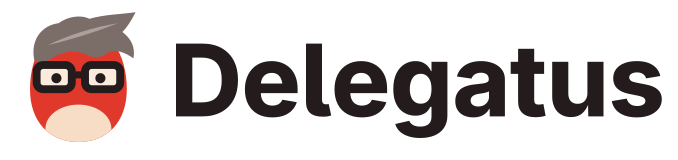
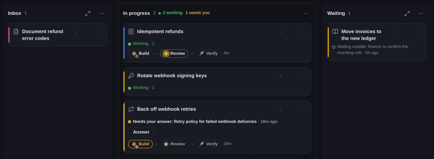
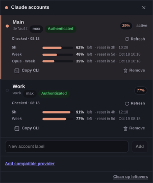

<p align="center">
  <picture>
    <source media="(prefers-color-scheme: dark)" srcset="public/brand/delegatus-lockup-on-dark.svg">
    
  </picture>
</p>

**Delegate everything.**

Delegatus lets you hand software work to AI coding agents and get it back
done. You tell an orchestrator what you want. It plans the work, starts
Claude Code, Codex and GitHub Copilot agents to do it, has other agents
review and check the result, and reports back. Turn on merging and it merges
what passes review as well. It runs on its own and stops to ask you only when
a decision is yours. You watch and steer from a board in your browser or on
your phone.


New here? The [Delegatus guide](docs/guide/README.md) takes you from installation to your first pipeline.

## Why Delegatus

Delegatus runs on your own machine with your own agent accounts. What it adds:

- **Every step is on record.** Any agent's conversation opens as a chat, and
  one search covers all of them.
- **Several accounts per engine.** Add more than one Claude, Codex or Copilot
  account and switch before a usage limit stops you.
- **Agents talk to each other.** A Claude Code agent can message a Codex agent
  and the other way round.
- **Shared memory.** Claude and Codex agents can look up what either engine
  learned, and a message you send can carry the memories that fit it.
- **Agents learn from their stages.** A pipeline stage can leave short rules
  that the next agents of its role, its project or the machine start with.
- **Telegram built in.** Agents post to chats you allow through a bot, and
  read your own Telegram account through a read-only MCP server.
- **Made for a team.** People sign in as themselves, and two machines can
  share one board.

<a id="run"></a>

## Quick start

These steps take you from nothing to an orchestrator working on your project.

1. Install [Bun](https://bun.com) 1.4 or newer:
   `curl -fsSL https://bun.com/install | bash`
2. Install Claude Code or Codex. The orchestrator runs on one of them.
   - Claude Code: `curl -fsSL https://claude.ai/install.sh | bash`
   - Codex: `curl -fsSL https://chatgpt.com/codex/install.sh | sh`

   You can add GitHub Copilot as well: `bun add -g @github/copilot`
3. Start Delegatus: `bunx delegatus-cli`. If neither CLI is found, the start
   output says how to install each.
4. Open `http://127.0.0.1:8898/` if your browser did not open it for you.
5. Follow the setup guide. It signs you in to your agent CLIs, asks for a
   project folder and creates the project's orchestrator.
   Using a service that speaks the Anthropic Messages API? See
   [Compatible providers](docs/guide/accounts-and-roles.md#compatible-providers).
6. Tell the orchestrator what you want done.

Linux is the main platform and macOS works; native Windows runs Claude Code
only, so use WSL 2 for the rest ([Platforms](docs/guide/getting-started.md#platforms)).
Copilot runs single agents; it cannot run the orchestrator. To keep a
`delegatus` command installed, change the port or set environment variables,
read [Configuration](docs/guide/configuration.md).

### From a clone

Use this to run Delegatus from its source code.

```bash
bun install
bun run build
bun bin/cli.mjs
```

The CLI serves the output of the last build, so build again after you pull.
`bun dev` runs the app with hot reload, and you start the runtime host for it
yourself.

To keep any install current, use **Updates** in the sidebar's ⋯ menu
([Updates](docs/guide/operations.md#updates)).

### Docker

The published image is `ghcr.io/latand/delegatus` for `linux/amd64` and
`linux/arm64`. Use `edge` for the latest main build or a version tag to pin a
release. From a repository checkout, start a test instance on port 8901:

```bash
DELEGATUS_IMAGE=ghcr.io/latand/delegatus:edge docker compose --profile test pull viewer-test
DELEGATUS_IMAGE=ghcr.io/latand/delegatus:edge docker compose --profile test up -d --no-build viewer-test
```

The Docker setup is how the maintainer runs Delegatus as a long-running
service. [docs/docker.md](docs/docker.md) is the runbook for a pinned
deployment, with a runtime host that owns releases and the listening port.

## How it works

Each project gets one orchestrator: the agent you talk to about that project.
You ask it for something in its chat. It opens a task on the project's board
and starts a pipeline for it: one agent builds the change, another reviews it,
and the builder fixes what the review found. The pipeline ends with its pull
request open for you to merge, or merged for you once you turn on **Merge when
the review passes**. The orchestrator files a short report each time a piece
lands, and the task's card says so when it needs a decision from you. Pipeline
stages run on Claude Code or Codex, on your own accounts; you and the
orchestrator can also start single agents, Copilot included.
[Core concepts](docs/guide/concepts.md) explains each part.

### The orchestrator

Write to it the way you would message a colleague: "take issues 12 and 14",
"fix the flaky test in the scanner", "review PR 30". For each piece of work it
opens a task, starts a pipeline in a worktree of its own and keeps the task's
card up to date. A decision it cannot make alone reaches you as a form with a
recommended answer for each question, in the **Decisions** tab beside its chat
and under **Needs you**.


More: [The orchestrator in depth](docs/guide/orchestrator.md).

### Tasks and the board

Each task is a card in one of four columns: Inbox, In progress, Waiting and
Done. A card shows the agents working on it, each pipeline with its stages and
pull request, and, when it needs you, what it is waiting for.



More: [A tour of the interface](docs/guide/interface.md).

### Pipelines and review loops

A pipeline runs one task through up to eight agent stages in a git worktree of
its own. Every review round starts a fresh reviewer, within a budget fixed when
the pipeline is created. Merging is off until you turn on **Merge when the
review passes**; until then the pipeline ends with its pull request open. The
picture at the top shows one.

More: [Pipelines in depth](docs/guide/pipelines.md).

<a id="agents-and-accounts"></a>

### Read any agent as a chat

Delegatus shows every Claude Code, Codex and Copilot conversation on your
machine as a readable chat, whoever started it, with diffs, command output and
one search across all of them.


Each account shows its five-hour, weekly and per-model limits.

<p align="center">
  
</p>

More: [Conversations](docs/guide/interface.md#conversations) ·
[Accounts, limits and roles](docs/guide/accounts-and-roles.md).

<a id="phone-access"></a>

### From your phone

The board's four columns become tabs you swipe between, and you hold a card to
move it. Open Delegatus on your phone through your Tailscale network.

<p align="center">
  
  
</p>

More: [From your phone](docs/guide/phone.md).

<a id="voice"></a><a id="telegram"></a><a id="team"></a><a id="linked-installs"></a><a id="external-relay"></a><a id="mcp-server-for-agents"></a><a id="connect-an-orchestrator-through-mcp"></a><a id="configuration"></a><a id="platform-support"></a>

## Everything else

| Feature | What it gives you |
| --- | --- |
| [Voice](docs/guide/voice.md) | Dictation, answers read aloud, voice conversations, Voice Delegatus |
| [Telegram](docs/guide/telegram.md) | A bot for reports and files; read-only access to your own account |
| [External relay](docs/guide/telegram.md#external-relay) | A relay service's chats answered by this install |
| [Team](docs/guide/team.md#team) | People sign in as themselves |
| [Linked installs](docs/guide/team.md#linked-installs) | Two machines share one board |
| [Memory](docs/guide/memory.md) | Learned rules for the next agents; memory shared by Claude and Codex |
| [MCP server](docs/guide/mcp.md) | Your own Claude Code or Codex sessions get the same tools |
| [Updates and services](docs/guide/operations.md) | Updates, automatic updates, memory and CPU limits for agents |
| [Configuration](docs/guide/configuration.md) | Command options, files, environment variables |

## Documentation

- [Delegatus guide](docs/guide/README.md): install, concepts, workflows and a
  page for every feature above.
- [docs/pipelines.md](docs/pipelines.md): stage definitions, verdicts, the HTTP
  API and recovery.
- [docs/orchestrator.md](docs/orchestrator.md): seat authority, mandate
  versions and rotation.
- [docs/review-loop.md](docs/review-loop.md): how a review round runs in a
  pipeline.
- [docs/docker.md](docs/docker.md): the long-running Docker runbook.
- [docs/RELEASING.md](docs/RELEASING.md): how a release is cut.
- [docs/merge-batch.md](docs/merge-batch.md): landing several reviewed pull
  requests as one batch.
- [ARCHITECTURE.md](ARCHITECTURE.md): how the scanner, API routes, runtime
  host and UI fit together.
- [CONTRIBUTING.md](CONTRIBUTING.md): commit identity, the privacy check, the
  local hooks and what CI runs.
- [docs/media/readme/](docs/media/readme/provenance.json): where the
  screenshots come from.

## Security

Anyone who can reach Delegatus can run commands as you. It binds to
`127.0.0.1`; any other bind address, and `--tailscale`, turn on the access key.
Treat a phone-access link as a secret.
[Security and privacy](docs/guide/security-and-privacy.md) has the rest.

## What leaves your machine

Delegatus sends one anonymous install ping per UTC day to
`https://delegatus.org/api/ping`, with exactly `id`, `v`, `os`, `arch` and
`kind`. Turn it off in the sidebar's ⋯ menu under **Settings → Install ping**,
or with `DELEGATUS_TELEMETRY=0` or `DO_NOT_TRACK=1`.
[What leaves your machine](docs/guide/security-and-privacy.md#what-leaves-your-machine)
has the details.

Memory profiles and voice-call summaries send selected rules or call text to
Anthropic through Claude Code, using your subscription. Limits are read through
Claude Code `/usage`. Delegatus's direct subscription-token request to Anthropic's
usage endpoint requires **Direct Anthropic API calls with my subscription** under
**Settings → Install ping → What leaves my machine**. It starts off on new installs;
existing installations with recorded direct usage keep it on.

## License

MIT
