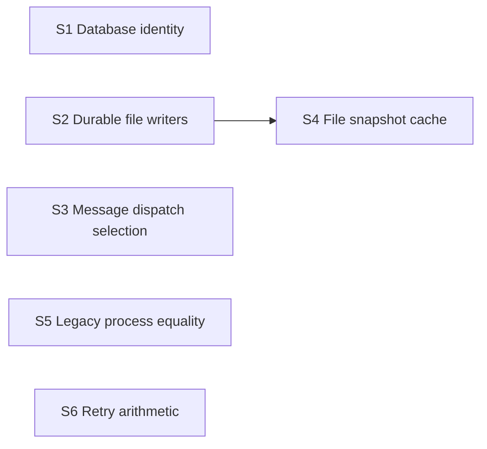

> After the current fix wave lands (identity #913/#916, wedge #925/#927, bubble #922, SQLite state wave #907), run a dedicated architecture audit: the codebase has accumulated visible repetition, and several of this week's incidents were drift between parallel copies of the same concept.

Source: operator request in issue #931, opened 2026-08-06. The issue also requires: “Each tranche must keep behavior pinned by the existing targeted tests before moving code.”

# Remaining duplicated mechanisms: October 2026 audit

Date: 2026-10-11. Status: proposed consolidation slices; design only.

The current assignment narrows that requirement to: “Re-verify the issue's seed list on current main (hand-rolled file-signature caches, parallel state machines, duplicate delivery paths, …) and extend it: find concepts implemented two or more times, with file:line evidence for each implementation and, where one exists, the incident or PR it caused. Drop what flow retirement or later migrations already removed.”

Recommend six small slices using existing owners. Begin with the database file identity helper and the durable writer already in the repository. Extract the remaining shared mechanics only where two current callers prove the seam. This document authorizes no product change, state mutation, deployment, or new automation engine. It proposes no additional ADR: these extractions are reversible and retain the existing decisions about storage, ownership, and automation.

## Evidence frame

Every source reference below is against main commit `e5cd0ff3d7e5d2c58225f908ad5c0bb475d2ccd2`. A fresh `git fetch origin main` returned that same commit as this lane's starting HEAD. Later implementers must recheck their exact merge base, especially files owned by ongoing migrations. A source reference identifies an implementation, rather than a measured production failure unless the text explicitly says otherwise.

Library paths in evidence tables are relative to `src/lib/`; component paths are relative to `src/components/`; API paths are relative to `src/`. Full paths are used for the implementation test contracts.

Read the full board task, issue #931, PR #1449, automation-v2 ADR 0001, `docs/design/retire-flows.md`, and `docs/design/state-sqlite-migration.md`; traced current callers and their test files. Repository instructions, README, CONTRIBUTING, hooks, and privacy configuration govern publication. No production census or broad test sweep was needed for this source audit.

Prior-solution searches used `search_transcripts` and `search_memory`, first for this project and then across projects, with phrasings including “931 duplicated mechanisms”, “cachedJsonFile”, “file-signature caches”, “flow retirement”, “signature cache”, and “backoffDelayMs”. Opened relevant memory hits and transcript context. The older freeze diagnosis points to the #928 hot-path cache incident; the retirement memory points to S1's historical relay identity extraction. A transcript about delivery delays distinguished observations from possible lock causes; it supplies no proof that duplicated dispatch caused those delays. The archived S1 transcript could not be opened through the current scanner roots. Public PRs and current code independently establish what shipped, so that historical access gap does not prevent this audit. No prior completed October consolidation plan was established by these searches. Private memory identifiers, account data, and transcript excerpts are intentionally excluded from publication.

Useful public history:

- [Issue #931](https://github.com/Latand/delegatus/issues/931) supplies the seed list and connects the older engine split to #925, transport drift to #912, and renderer behavior to #930.
- [PR #1449](https://github.com/Latand/delegatus/pull/1449) owns automation-v2's design. Its [ADR 0001](automation-v2/adr/0001-one-record-extend-pipeline-retire-flows-and-workflows.md) selects the pipeline record and retirement of flows/workflows.
- [PR #1945](https://github.com/Latand/delegatus/pull/1945) landed the pure historical relay identity extraction. [PR #2014](https://github.com/Latand/delegatus/pull/2014) landed explicit legacy review-loop conversion; its description leaves flow actuation retirement to S5.
- [Issue #1870](https://github.com/Latand/delegatus/issues/1870) records lost state after a hard reboot. [PR #1893](https://github.com/Latand/delegatus/pull/1893) introduced the durable file writer and database recovery work. Its original connection-reopening limitation has since been addressed by `currentDatabase.ts`; current tests cover a connection held across restoration.

## Re-verification of all six seeds

| #931 seed | What current main actually contains | Audit disposition |
| --- | --- | --- |
| 1. Three `{path}:{mtimeNs}:{size}` caches | `pipelines/store.ts:1301` and `flows/store.ts:287` use `SqliteStateCollection`. Their remaining projection caches key on collection signatures (`pipelines/store.ts:1326`, `flows/store.ts:130`), with different copy/mutation contracts. `scanner/projectState.ts:103` mixes collection revisions with legacy file signatures and hashes project attribution facts. | Drop the obsolete three-file-cache refactor. Retain the ordinary JSON reader family below as a newly verified extension. Do not force SQLite projections or project attribution into a JSON helper. |
| 2. Whole-file JSON stores | Pipelines, flows and workflows now use the shared collection implementation (`pipelines/store.ts:1301`, `flows/store.ts:287`, `workflows/store.ts:356`). Legacy imports and rollback mirrors remain. | Storage has a shared seam. Flow/workflow store retirement and legacy-path deletion belong to their existing plans. Remaining file writers are classified separately below. |
| 3. Parallel state engines | `flows/engine.ts:1193` still ticks flows; `workflows/engine.ts:551` still ticks workflows; `pipelines/engine.ts:3164` still interprets review-flow retry detail. | Still present, already owned by ADR 0001 and flow retirement. Exclude a second engine-consolidation tranche. S1 and S4 landing does not prove retirement complete. |
| 4. MCP bindings vs HTTP routes | `mcp/bindings.ts:6059` routes conversation actions through `/api/conversation-host` at `:6089`; `/api/tmux` imports the same handlers (`app/api/tmux/route.ts:1`). `app/api/orchestrator/message/route.ts:59` delegates local relays to that handler. | The specific conversation-action split is resolved in code, although #912 remains open for a broader set of symptoms. Do not mark the whole issue fixed. Remaining local/linked dispatch duplication is inventoried below. |
| 5. Multiple message-markdown renderers | Outbox rows use `UserMessageRow` (`conversation/OutboxBubbles.tsx:353`); that row uses `feed/markdown.tsx` through `mdBlocks` (`feed/UserMessageRow.tsx:16,117`). Live prose uses `StreamingMd` from the same module (`conversation/LiveTurnRows.tsx:39,477`); its unfinished-tail renderer calls `md` (`feed/markdown.tsx:850,867`). Transcript protocol prose uses `mdBlocks` (`feed/cards/ProtocolMessage.tsx:104`). | Drop the proposed merger of these message grammars: they already share the module. Streaming state and standalone document layout serve distinct inputs. Frontend redesign and #930 review-format work remain outside these backend slices. |
| 6. Approximately 5,000-line registry | `agent/registry.ts` is now 10,296 lines. Storage has an adapter (`agent/sqliteRegistryStore.ts:1`) and there are extracted identity, admission and projection modules, but registry mutations still coordinate delivery, host custody and migration. | Size alone cannot select a safe extraction. Take the specific repeated identity/dispatch mechanics below; defer a general registry decomposition. Preserve one transaction for decisions involving several collections. |

## Remaining inventory

The six families below each have at least two current implementations. “Related history” identifies an incident class or originating PR; it does not assert that every surviving copy caused that incident.

| Family | Implementations and their differences | Related history and risk |
| --- | --- | --- |
| A. SQLite database file identity | `state/currentDatabase.ts:41` uses bigint `dev:ino` and returns `null` if unavailable. `accounts/accountsStore.ts:437` and `bridge/store.ts:413` independently use numeric `dev:ino` and an `absent` sentinel to invalidate cached collections. | #1870 / #1893 and `state/durability.test.ts:392,551` establish the replaced-database hazard. Duplicate probes invite differing identity precision and missing-file handling. The collection caches and the transaction fence are different responsibilities. |
| B. Publishing whole-file state | `state/durableJson.ts:37` writes an exclusive private temporary file, fsyncs it, renames, fsyncs the directory, and cleans up. `operator/settings.ts:128` and `projects/settings.ts:186` have separate private temp/rename writers returning a boolean. `links/state.ts:41` has a compact JSON temp/rename writer that throws. Other copies include `orchestrator/seats.ts:217`, `roles/store.ts:38`, `projects/curation.ts:139`, `session/titleStore.ts:38`, and `agent/artifacts.ts:5`. | #1870 documents loss from the missing durability pattern. #1893 supplies the surviving implementation. The settings and link files still bypass it. Several other listed files have existing migration owners or are disposable artifacts; classify them before changing them. |
| C. Choosing a structured send or its legacy fallback | `app/api/conversation-host/handlers.ts:583` enqueues a structured request and falls back only on a null result at `:606`. `links/seatMessageDelivery.ts:42` independently enqueues and falls back at `:53`, then maps receipts into peer acknowledgements. | #912 explains why operation ownership matters. [PR #2660](https://github.com/Latand/delegatus/pull/2660) introduced the linked path. Duplicated transport choice can drift into retrying an accepted/uncertain send. Authorship, attachments, sharing guards and peer receipt interpretation legitimately differ. |
| D. Stat-keyed decoded JSON snapshots | `projects/settings.ts:134`, `operator/settings.ts:89`, `projects/curation.ts:105`, and `forge/cache.ts:141` each stat, compare path/mtime/size, read, decode and memoize. The forge copy also memoizes an indexed view on `globalThis`; settings readers keep domain defaults and copy policies. | #931 seed 1 and [PR #928](https://github.com/Latand/delegatus/pull/928) establish the hot-path reparsing class. No current GC storm was measured. Current readers omit inode identity, so an equal-size replacement preserving mtime can keep an old memo. |
| E. Recorded process equality | `processIdentity.ts:116` owns a pid/start comparison with an optional expected boot epoch. Two-field equality is repeated in `accounts/migration/contracts.ts:219`, `lifecycle/owners.ts:100`, and `runtime/interruptionObligations.ts:196`. Other host comparisons combine this with endpoint, generation or pane evidence. | [PR #1375](https://github.com/Latand/delegatus/pull/1375) introduced boot-aware ownership proof. Equality drift can misattribute a cut or an owner. Equality, liveness, and permission to signal are separate decisions. |
| F. Exponential retry spacing | `deadline.ts:122` is a capped, injectable pure calculation. `runtime/retryBackoff.ts:16`, `streamMux/client.ts:297`, and `accounts/codexRuntime.ts:514` each calculate another exponential. MCP already delegates to the shared helper (`mcp/bindings.ts:323`). | [Issue #845](https://github.com/Latand/delegatus/issues/845) is the shared helper's retry-storm motivation. [PR #2572](https://github.com/Latand/delegatus/pull/2572) and [PR #2684](https://github.com/Latand/delegatus/pull/2684) identify the delivery/stream callers. Their ceilings and attempt numbering differ; no new incident is attributed to these copies. |

## Ranked slices

Rank estimates the seriousness and reach of the failure class divided by the amount of behavior that must move. It is qualitative: this audit has neither production frequency counts for current duplicates nor measured implementation hours. Size counts describe implementation surfaces, excluding tests. High consequence with a tiny extraction ranks ahead of a large cleanup even when the latter deletes more lines.

| Rank / slice | Risk removed | Expected change size | Why this position |
| --- | --- | --- | --- |
| 1 — Database identity | Drift at file replacement and collection-cache invalidation | Small: two probes replaced by one existing export | Lowest migration burden; recovery consequence is substantial and the common primitive already exists. |
| 2 — Remaining durable file writers | Lost settings or link authorization state after a crash; inconsistent publication guarantees | Small to medium: three writer bodies plus failure-contract coverage | Concrete historical loss class; reuse #1893's mechanism and avoid touching stores scheduled to migrate. |
| 3 — Message dispatch selection | An accepted structured send falling through to a second transport | Medium: two dispatch blocks and one extracted module | High consequence; needs careful two-entry-point tests and preservation of security/order contracts. |
| 4 — Ordinary JSON snapshots | Stale replacement reads and repeated parsing-policy implementations | Medium: four readers, one extraction | Four callers justify a seam. Cache ownership and normalization need characterization before movement. |
| 5 — Legacy process equality | Inconsistent owner/cut comparisons | Small to medium: three predicates and their contract tests | Existing helper survives, but compatibility must be explicit; widening this to liveness would multiply risk. |
| 6 — Retry arithmetic | Spacing drift across repeated wake/reconnect paths | Small: two calculation sites | Low consequence of the duplication itself; cheap only while state, scheduling and retry budgets stay in their owners. |

### S1. Reuse the database identity probe

**Survivor:** `databaseFileIdentity` in `state/currentDatabase.ts:41`. Move `accountsStore.ts:437` and `bridge/store.ts:413` to that export; retain their per-file/per-collection maps, factory arguments and import behavior. Adapt the helper's `null` to the caller's current `absent` convention, or change both cache identity types consistently in this slice. Do not add a connection pool or another store base class. `openCurrentDatabase` remains the owner of reopening and refusing a commit into a replaced file.

**Behavior pins:** `src/lib/accounts/accountsStore.sqlite.test.ts` pins import-once, rollback and committed account state; `src/lib/bridge/store.sqlite.test.ts` pins replay dedupe, cursor round trips and revisions. `src/lib/state/durability.test.ts` includes the held-connection restore and fresh-fallback production-store cases at `:392,551`.

**Required before moving callers:** add consumer cases that hold a collection, replace its database at the same pathname without calling the test reset helper, and then read/write only the replacement. Cover absent → created → replaced identities and preserve the missing-file fallback. These cases are proposed additions; current import tests do not establish that complete matrix. Acceptance is two removed probe implementations, unchanged persisted schemas and import semantics, and passing replacement cases through both consumers.

**Order:** independent of flow retirement and S2. Do not alter the swap marker, connection transaction fence or authority for restoration. Recheck concurrent storage work before editing the account/bridge files.

### S2. Finish durability for files that remain files

**Survivor:** `writeJsonDurably` / `writeTextDurably` in `state/durableJson.ts:20,37`. First move `operator/settings.ts:128` and `projects/settings.ts:186`; then move `links/state.ts:41` as a separately reviewable commit in the same slice or an immediate follow-up. Keep settings' boolean failure return, successful cache invalidation, caller normalization, 0600 files and existing 0700 directory creation. Keep links' throwing contract and compact JSON via `{ space: 0 }`.

**Behavior pins:** `src/lib/operator/settings.test.ts` covers detected/chosen language precedence, malformed settings and file mode. `src/lib/forge/autoMergeStore.test.ts` covers project merge settings; `src/lib/projects/reportDestination.test.ts` covers explicit log-only vs never chosen and legacy/topic destinations. `src/lib/links/pairing.test.ts` and `src/lib/links/seatMessages.test.ts` exercise grants, peers, sharing and durable queue state; `src/lib/state/durableJson.test.ts` pins Windows file/directory flushing behavior.

**Required before moving callers:** add ordered filesystem-failure cases to the durable writer tests: file flush precedes rename; directory flush follows rename; failures before rename leave the previous file readable and remove the owned temporary file. Add consumer assertions preserving each return/throw contract and cache invalidation. A directory flush failure after rename may already have published the new bytes: report failure, retain those bytes, and do not restore or delete another writer's file. Document this acknowledgement limit in the shared writer tests. A simulated call-order test cannot prove physical power-loss behavior.

**Acceptance:** no second temp/rename implementation in these three owners; existing serializers and failure responses remain compatible; private modes and cleanup are pinned. Keep settings writes free of new startup imports/migrations. No broad conversion of executable files: the surviving helper always writes 0600 and therefore cannot replace a writer that owes 0700 scripts.

**Order:** precede S4, which shares the settings files. Let the existing SQLite migration own seats, presets, titles and curation; do not perform an interim wholesale rewrite of those writers. Review the links change with its own security-state tests before expanding beyond `links/state.ts`.

### S3. Share transport selection after admission

**Survivor:** extract the selection rule from `conversation-host/handlers.ts:583` into a library module, proposed `src/lib/conversation/messageDispatch.ts`. It takes already prepared structured/legacy requests and injected dispatch ports. A non-null structured result, including refusal or uncertainty, is terminal for selection. Only a null result permits the legacy call. Return a tagged result identifying the selected transport so callers retain their own response interpretation.

Move the handler and `links/seatMessageDelivery.ts:42` to it. Keep `structuredHostsEnabled()` at its current owner; the linked path's current unconditional structured probe stays unconditional. Preserve each caller's request fields and trimming, the handler's revalidated actor, and the linked `admissionGuard` passed to dispatch. Do not import a Next route or instrumentation into the library. Do not make another HTTP request inside a library caller.

**Behavior pins:** `src/app/api/conversation-host/route.test.ts`, `src/lib/links/seatMessages.http.test.ts`, and `src/lib/runtime/structuredMessageDelivery.keyed.test.ts`. Linked tests already cover a lost committed answer, restart around admission, recipient rotation, revoked sharing and unchanged operation identity. `src/lib/delivery.test.ts` pins the legacy path.

**Required before moving callers:** exercise both real entry points with a structured accepted result, a refused result, an operation-backed uncertain result, an exception, and null. Count dispatch calls: zero legacy sends for every non-null result or exception; exactly one on null. Revoke authority/sharing while admission is held and assert the unchanged guard refuses actuation. Lost-response replay retains the original operation and produces no second delivery. Keep attachment retention and member attribution tests on the HTTP entry point.

**Acceptance:** one transport selection implementation, both public responses preserved, no fallback on uncertainty, and no extra receipt lookup that could reinterpret an admitted send as a fresh one. Peer retry/receipt mapping stays in the linked adapter. Structured queue, runtime journal and legacy transport remain distinct owners of their effects; this slice creates no delivery state machine.

**Order:** independent of S1/S2/S4. Reserve both entry-point files in one lane and recheck any overlapping linked-install or delivery work. This slice does not wait for flow retirement because it moves no flow caller.

### S4. Extract the ordinary file snapshot cache

**Survivor:** the stat/read/memo lifecycle from `forge/cache.ts:141`, extracted into proposed `src/lib/state/cachedJsonFile.ts`. Move ordinary file mechanics from forge cache, project settings, operator settings and project curation. Keep the forge's `forgeViewOf` projection, `globalThis` memo lifetime, and all domain decoders/defaults/copy policies in their current owners.

The narrow interface is a per-owner cache that binds its decoder at construction and exposes `read(path)` and `invalidate()`. It owns the observed file token and decoded memo; a warm read cannot accidentally reuse a value under a different decoder. The decoder owns fallback/error behavior. Use path, device/inode, size, nanosecond mtime and ctime to distinguish replacements. Compare the token before/after a read; a changed or unavailable observation must not be published as a stable memo. This is an explicit improvement over the current path/mtime/size keys, requiring regression coverage. Keep the returned value's ownership policy at each caller.

**Behavior pins:** the settings and curation tests named for S2 plus `src/lib/projects/curation.test.ts`; `src/lib/forge/sweep.test.ts` pins cache-only reads, failed-sweep preservation and immediate report provenance. `src/lib/operator/settings.test.ts` also establishes the malformed-file fallback. Do not use `readJsonCache` here: `state/durableJson.ts:64` can discard an unparseable rebuildable cache, whereas settings/curation are operator-authored data that must be kept.

**Required before moving callers:** add focused cache tests for zero rereads on a warm key; path switch; write/invalidate; deletion/recreation; equal-size/equal-mtime rename; replacement during read; and unreadable/malformed input. Consumer cases pin their actual copy/reference behavior, default handling, and forge view reuse. A replacement during read can return the observed decode once, but must leave the memo cold so the next read observes the new file. Never delete a source file.

**Acceptance:** four callers share one memo lifecycle, stable reads remain cheap, and replacement cases change the answer on the next read. A benchmark for these small files is unnecessary unless characterization shows a new hot-path cost; do not infer #928's production load from this inventory.

**Order:** after S2 for shared settings edits. Curation may migrate first: if it does, drop that caller rather than rebuilding a file abstraction around SQLite. Exclude flow/pipeline projection caches, registry/WAL signatures, transcript head/tail readers, and `projectResolutionStateKey`; their revision, completeness and attribution contracts differ.

### S5. Share recorded equality while keeping legacy policy

**Survivor:** `sameRecordedProcessIdentity` in `processIdentity.ts:116`. Move the local predicates in migration contracts, lifecycle owners and interruption obligations. Their present contract compares pid/start only. Pass an explicit expected `{ pid, startIdentity }` projection for those legacy comparisons so optional boot metadata does not silently strengthen their behavior. Keep null handling at the caller and composite endpoint/generation comparisons around the primitive.

**Behavior pins:** `src/lib/processIdentity.test.ts`, `src/lib/lifecycle/owners.test.ts`, `src/lib/runtime/interruptionObligations.test.ts`, and `src/lib/accounts/migration/coordinator.test.ts`. Interruption tests pin one obligation when a released cut is rediscovered and a distinct obligation for a later cut; lifecycle tests cover host and admission owners.

**Required before moving callers:** characterize the three predicates for same pid/different start, null start, and records with absent/equal/different boot metadata. Add shared-helper cases for a boot-aware expectation versus a legacy expectation, and consumer cases proving the old two-field truth table is unchanged. Acceptance removes three duplicate comparisons without changing who may take a fence, authorize a signal, or deduplicate a cut.

**Order:** no dependency on S1–S4. Land only after the compatibility matrix is explicit. `agent/accountLiveness.ts:112` treats unknown identity as potentially alive; `processIdentity.ts:82` returns unverified and uses boot evidence. These intentionally distinct liveness policies are excluded. Replacing every `pidAlive` or identity-shaped predicate with one boolean would hide policy and requires a separate requirement.

### S6. Reuse retry arithmetic, retain retry owners

**Survivor:** `backoffDelayMs` in `deadline.ts:122`. Move `RetryBackoff.nextDelayMs` and `streamMux/client.ts:297` to it. Runtime maps zero-based failure count to attempt `failures + 1`, with base 1,000, ceiling 30,000 and zero jitter; the stream passes its one-based count and existing reconnect constants. Keep `RetryBackoff.ready/fail/reset`, stream timers, success resets, fallback probing and each scheduler where they are.

**Behavior pins:** `src/lib/deadline.test.ts`, `src/lib/streamMux/client.test.ts`, and the runtime queue tests `src/lib/runtime/structuredDeliveryQueue.test.ts` and `src/lib/runtime/structuredDeliveryQueue.recoveryContention.test.ts`. The latter pins a contention schedule, which must remain unchanged even though that separate calculation is not moved here. Add a focused `src/lib/runtime/retryBackoff.test.ts` for ready/fail/reset and unrelated wakes; it does not exist in this snapshot.

**Required before moving callers:** compare delays at first failure, repeated failures, saturation and reset, including the stateful caller's increment-after-scheduling rule. Acceptance preserves exact existing times and installs no new jitter, timer, retry ceiling or scheduler. Exclude `accounts/codexRuntime.ts:514` initially: its exponent caps at eight, making its actual saturated delay 25,600 ms despite an outer 30,000 cap. A later arithmetic-only move must use a capped ordinal or that actual ceiling; changing it to 30 seconds would change behavior.

**Order:** independent, lowest priority. A two-site extraction is sufficient. Do not create a universal retry controller or mix provider-reset times, publication retries, account mutation waits, and delivery contention budgets into one policy.

## Sequencing and verification contract

The arrow is a file-ownership constraint. The other slices can proceed independently, subject to current lane ownership. Characterize behavior through existing consumers before movement; extend tests where the matrix above is missing. A slice is done when the replacement serves the callers, the old implementation is deleted, and its behavior checks pass. A compatibility re-export is acceptable during an explicitly bounded migration; an indefinitely retained second implementation is unfinished.

Run each named test by explicit path through `bash scripts/gate-slot.sh bun test <file>`, with isolated HOME, XDG config, TMPDIR and `LLV_STATE_DIR`. Choose the test sandbox under the OS temporary root, outside operator state; a stage's inherited scratch may be operator-owned. Run relevant types/lint and scoped publication checks as the repository hooks require. For S3, also exercise an isolated production build because moving a library import can change Next's server bundle graph. UI captures are required only if a later tranche changes rendered surfaces. This design introduces no such surface.

For a small extraction, rollback is a normal revert with no data conversion. S2's files keep their existing shapes; a reverted older writer can still read them, although it loses the stronger durability guarantee. S4 changes only in-memory tokens. S3/S5/S6 change no persisted state. Existing storage/flow cutovers retain their own rollback and history contracts.

## Variants and trade-offs

1. **Bounded extraction now — recommended.** Deliver S1–S6 in ranked slices, with S2 before S4; existing storage/flow owners keep their work. This addresses surviving copies promptly and concentrates verification on real consumers. Rebase/re-inventory before each slice to avoid a migration removing its target.
2. **Storage-first consolidation.** Wait for existing storage and flow retirement to finish, then repeat the inventory and implement only the survivors. This minimizes repeated edits to migrating files, but delays durability and dispatch cleanup in the newer settings/link paths that those older inventories do not explicitly cover.

Both variants preserve the established pipeline and SQLite owners. Variant 1 is selected because the highest-ranked extractions can proceed without changing those designs. No operator decision is needed to publish this audit; implementation remains future, reviewable work.

## Deferred — not currently justified

- **A fresh automation facade or engine.** ADR 0001 and flow retirement already own removal of the parallel engines. Keep their frozen history and explicit conversion plan; do not add another representation.
- **A second SQLite migration or generic store framework.** The shared collection module already owns storage. Seats, presets, titles, curation and remaining legacy paths stay with the existing migration plan. Their temp/rename copies are inventory evidence, rather than extra work assigned here.
- **A complete registry split.** Its line count documents a maintenance burden, but does not establish which cross-collection transactions can be separated. Require a named repeated responsibility and a consumer behavior matrix before cutting another module. The six slices above do not move registry transaction ownership.
- **Unifying every file signature.** Database inode identity, database/WAL content revisions, scanner attribution keys, completeness-aware transcript windows and ordinary JSON snapshots have different invalidation contracts. `agent/registry.ts:4097` and `agent/sqliteRegistryStore.ts:2049` share five stat fields but differ in files composed and error mapping; retain them until a remaining caller set justifies a separate primitive.
- **One process-liveness policy.** Missing kernel evidence, legacy records and authority to kill/take over need explicit policy. S5 shares equality only. Migrating all records to boot-aware custody is separate behavioral work.
- **A universal delivery queue or receipt interpreter.** Local operator delivery, linked peer acknowledgement, runtime effects and voice batching have distinct principals and guarantees. S3 shares selection; peer receipts remain in their adapter. `runtime/bridgeDelivery.ts:17` already reuses voice delivery and is excluded from the duplication count.
- **Frontend markdown or document redesign.** The named seed's message grammar is shared today. Document parsing and review finding formats need their own requirements, tests and rendered evidence. No frontend consolidation lane is proposed here.
- **A retry framework, cancellation rewrite or runtime timeout sweep.** Pure arithmetic is enough for S6. Runtime RPC deadline constants already have one owner (`runtime/deadlines.ts:9`) and a source-scanning regression (`runtime/deadlines.test.ts:51`); keep that completed consolidation. Account persistence's 25,600 ms cap and every provider/lock budget stay unchanged.
- **Global duplication lint or line-count targets.** Similar syntax is insufficient evidence of shared policy. Per-slice behavioral tests and deletion of displaced implementations are the acceptance; no new architectural policing mechanism is warranted.

## Validation against the originating requirement

| Requirement | Result |
| --- | --- |
| Re-verify and extend the seed list on current main | All six seeds classified against the pinned main SHA; six surviving families have at least two file:line implementations. Retired mechanisms are removed from the proposed backlog; unfinished but already owned work is identified explicitly. |
| Ground repetition in incidents/PRs where available | Public issue/PR history is linked, with incident classes distinguished from newly inspected copies. No production-frequency claim is invented. |
| Rank reviewable tranches with a survivor, callers, behavior pins and ordering | S1–S6 supply those fields, additional acceptance cases and explicit exclusions; S2 → S4 is the only required inter-slice dependency. |
| Design only; English; privacy from the merge base | Only this design document is delivered. Check `git diff --check` and run the local privacy gate against the exact merge base with committed known-value fingerprints and commit checks. Source-reference file/line bounds and named existing test paths are checked separately. Product tests listed above are future tranche obligations, not claims of tests run for this document. |

The proposed work serves the original drift-reduction requirement through removal of specific remaining copies. Deferred work stays visible here. There is no unresolved requirement interpretation or external behavior fact needed to judge the audit.
