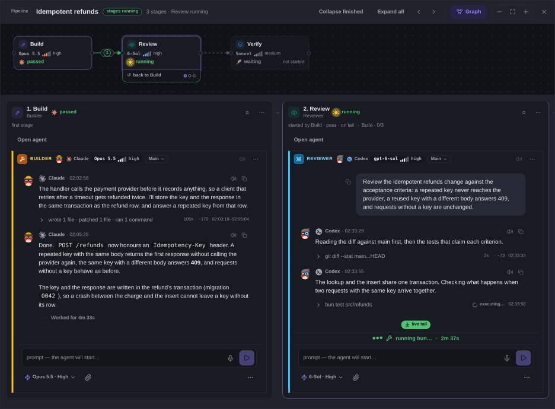

# Getting started

This page takes you from nothing to an orchestrator working on your project,
and then to a first pipeline that delivers its branch or pull request. Terms in it are
explained in [Core concepts](concepts.md).

## What you need

Delegatus runs on your own machine and drives the agent command-line tools
you already use.

- Bun 1.4 or newer. On Linux the installer needs `unzip`; install it with
  your package manager first if it is missing. Then install Bun:

  ```bash
  curl -fsSL https://bun.com/install | bash
  ```

  The installer adds Bun to your shell's startup file, which only new
  terminals read. Open a new terminal, or make it available in this one:

  ```bash
  export BUN_INSTALL="$HOME/.bun"
  export PATH="$BUN_INSTALL/bin:$HOME/.local/bin:$PATH"
  bun --version
  ```

  `bun --version` must print 1.4 or newer before you go on. `~/.local/bin`
  is where the Claude Code installer puts `claude`. Bun's
  [installation page](https://bun.com/docs/installation) covers other
  systems and problems.
- Claude Code or Codex. The orchestrator runs on one of them, so install
  at least one:
  - Claude Code: `curl -fsSL https://claude.ai/install.sh | bash`
  - Codex: `curl -fsSL https://chatgpt.com/codex/install.sh | sh`

  GitHub Copilot is optional: `bun add -g @github/copilot`. It runs single
  agents only and cannot run the orchestrator. When Delegatus reports Copilot
  missing, its message names the exact package version to install.
- git and a project folder. Delegatus can initialize a safe new folder, make
  its first local commit and start the pipeline. [Prepare a project for
  pipelines](#prepare-a-project-for-pipelines) explains the exclusions and
  the optional remote.
- For pull requests and merging: an `origin` on GitHub, and the GitHub
  CLI (`gh`) signed in. Without a GitHub pull request, pipelines end without
  a merge, and a stopped merge names a signed-out `gh` as its reason.
- Linux or macOS. Linux is the main platform and macOS works. Native
  Windows runs Delegatus with Claude Code only; use WSL 2 for Codex, the MCP
  server and the rest. [Platforms](#platforms) has the details.

### Platforms

Delegatus is built for Linux and also runs on macOS and Windows.

On Linux, each managed agent runs inside a signal boundary where it is
available: its own kill, pkill, killall or fuser reaches only processes it
started. The boundary needs Bubblewrap (`bwrap`), Python 3, util-linux,
unprivileged user and PID namespaces, and a systemd user manager that
delegates the cpu, memory and pids cgroup controllers. Where any of these is missing, and on macOS and Windows,
agents launch without the boundary and the launch reports it as off with the
cause. A missing boundary never stops a launch. Known gaps: an agent can still
reach the systemd user manager, Docker and a tmux server of the same user, which can
act on other processes of the same user.

macOS works through a backend that uses `ps` and `lsof` in place of `/proc`.
Native Windows runs Delegatus with Claude Code; install Claude with its
native installer so a `claude.exe` is on `PATH`. Codex, managed accounts,
local dictation, the MCP server and `--tailscale` are missing there, so run
under WSL 2 if you need them. Windows also has no open-file scan, so
Delegatus judges whether an agent is alive from file modification times.

## Choose how to install

On a Mac, start with the app. The command-line options also work on the
platforms listed above.

- **Mac app.** Download `Delegatus-<version>-mac.dmg` from the
  [latest release](../../../../releases/latest), drag Delegatus to Applications
  and double-click it. Confirm the private installation once, then follow the
  setup guide inside its window. Bun and Delegatus are installed for your user;
  Claude Code and Codex are connected separately in the guide.
- **Run the package.** For trying it out: `bunx delegatus-cli`.
- **Keep a command installed.** For daily use: `bun add -g delegatus-cli`.
- **Let your coding agent install it.** If you already work in Claude Code or
  Codex: paste the install prompt from the Delegatus website.
- **Run from a clone.** To read or change the source.
- **Docker.** For a long-running server, or a look at the interface.

### Run the package

```bash
bunx delegatus-cli
```

This downloads and runs the published package without installing a command.
Update it from the **Update** dialog, or run `bunx delegatus-cli@latest`.

### Keep a command installed

```bash
bun add -g delegatus-cli
```

This installs three commands into `~/.bun/bin`: `delegatus`, its short alias
`dlg`, and `delegatus-mcp`, the MCP server agents use to reach Delegatus.
`bun add -g` needs no root. Start Delegatus with `delegatus`; `delegatus
--help` lists its options. The command stays installed. Update it from the
**Update** dialog, or run `bunx delegatus-cli@latest`.

### Start at login

For an installed command on Linux or macOS, opt in with:

```bash
delegatus service install
# A different local port:
delegatus service install --port 9123
```

It writes a per-user service, starts Delegatus when no other instance is
running, and prints its file, log and undo command. It needs no elevation.
Check with `delegatus doctor`; remove it with `delegatus service remove`.
If Delegatus already runs from a terminal, finish that work, run
`delegatus stop --all`, then repeat the install command to start the service.
An older installed command needs `bun add -g delegatus-cli@latest` first.
Temporary `bunx` copies and checkouts keep their own start procedure.
See [operations](operations.md#running-as-a-user-service) for limits and logs.

### Let your coding agent install it

The Delegatus website, [delegatus.org](https://delegatus.org), has an install
prompt for Claude Code and one for Codex. Paste it into a session of that
agent and it does the following, in order:

1. checks for Bun 1.4 or newer and installs it if needed;
2. checks for the agent's own CLI and installs it if it is missing;
3. installs the package with `bun add -g delegatus-cli`;
4. asks whether to start at login, runs `delegatus service install` if you
   agree, and otherwise starts it in the background with `--no-open`; then
   waits for `http://127.0.0.1:8898/` to answer;
5. registers the MCP server for that agent under the name `viewer`, which
   takes effect in the agent's next session;
6. gives you the link to open.

The command stays installed, and it updates like the installed command.

On native Windows it stops after the first step and asks you to run it inside
WSL 2. On macOS the Claude desktop app needs the separate Claude Code CLI,
and the Codex app may carry a CLI of its own;
[docs/macos-newcomer.md](../macos-newcomer.md) explains what the prompt
checks there.

### Run from a clone

Get the source first. Its address is the **GitHub** link at the top of
[delegatus.org](https://delegatus.org). Clone it and enter the checkout; every
command below runs from there:

```bash
git clone <repository URL> delegatus
cd delegatus
bun install
bun run build
bun bin/cli.mjs
```

The command serves the output of the last build, so build again after every
pull. `bun dev` runs the app with hot reload, and with it you start the
runtime host yourself. No `delegatus` command stays installed. Update from
the **Update** dialog, or pull and build again; [Updates](operations.md#updates)
covers keeping a clone current.

### Docker

You do not need Docker for agents or pipelines: the packaged command already
starts and supervises its own runtime host. Docker has two setups, and both
run from a clone of the source (see [Run from a clone](#run-from-a-clone) for
getting one), because `docker-compose.yml` is at the top of that checkout.

- **The test Viewer** shows the interface over your existing transcripts and
  nothing more. It is the web app alone, without a runtime host, so it
  cannot start an orchestrator, an agent or a pipeline. The
  [Run the published image](../docker.md#run-the-published-image) section of
  docs/docker.md has its two commands. It opens
  on `http://127.0.0.1:8901/`, runs in the background, and stops with
  `docker compose --profile test stop viewer-test`.
- **The production setup** is the Docker installation that runs agents. Its
  runtime host owns `http://127.0.0.1:8898/` and starts the web app as a
  release it can replace. Follow [Production
  instance](../docker.md#production-instance) in docs/docker.md from top to
  bottom: pull the images, keep a first Viewer on port 8898 while the
  bootstrap builds the first managed release, then start the runtime host
  and check that port 8898 answers. Agents started there run the `claude`,
  `codex` and `bun` installed on the host, so install them on the host first.
  `docker compose --profile runtime-host stop runtime-host` stops the
  runtime host and with it the listener on port 8898. No `delegatus` command
  stays installed; `scripts/rebuild.sh` updates the production setup.

After the production setup answers on port 8898, continue at [The setup
guide](#the-setup-guide).

## Start Delegatus

This section is for the package, the installed command and the clone. A
Docker production setup is already running once its runtime host answers.

Run the command for your install path. Delegatus listens on
`http://127.0.0.1:8898/` and opens it in your browser when it can.

- `--port <n>` (or `-p <n>`) picks another port. If the port is busy, the
  start output says so and suggests the next one, for example
  `bunx delegatus-cli --port 8899`.
- `--no-open` leaves the browser closed; open the address yourself.
- If neither Claude Code nor Codex is found, the start output prints both
  install commands above. Install one, restart Delegatus and open the setup
  guide.

The command starts two processes: the web app, and the runtime host that
launches and supervises agents. Ctrl+C stops both.

Delegatus reads the transcripts already on your machine, from
`~/.claude/projects`, `~/.codex/sessions` and `~/.copilot/session-state`, so
your earlier agent sessions appear as chats straight away.

The first start shows a notice about the anonymous install ping, in the page
and in the start output. Turn it off in the sidebar's ⋯ menu under
**Settings** → **Privacy**, or start Delegatus with
`DELEGATUS_TELEMETRY=0` or `DO_NOT_TRACK=1`.
[What leaves your machine](security-and-privacy.md#what-leaves-your-machine)
lists what it sends.

## Open Delegatus as an app

**On a Mac:** use the native app from [Choose how to install](#choose-how-to-install).
It starts Delegatus and gives it its own window and icon. Its menu offers
**Start at Login**, **Stop Delegatus**, **Check for Updates…** and **Open Logs**.
Quitting the window can leave the server and agents running; Stop asks for
confirmation and stops the agents too.

The initial release is ad-hoc signed. On macOS 13–14, Control-click (or
right-click) Delegatus, choose **Open**, then confirm **Open**. On macOS 15
and later, double-click once, dismiss the warning, open **System Settings →
Privacy & Security**, choose **Open Anyway** next to Delegatus and confirm.

Delegatus serves a web app manifest, so a browser can give it its own window
and icon instead of a tab.

- **Chrome** on a computer: open Delegatus, then click the install icon in
  the address bar, or open the ⋮ menu and choose **Cast, save, and share** →
  **Install page as app** (some versions show **Install Delegatus** in the
  menu directly). The app opens in its own window with the Delegatus icon,
  from `127.0.0.1` as well.
- **Edge** on a computer: click the install icon in the address bar, or open
  the **Settings and more** (⋯) menu and choose **Apps** → **Install this site
  as an app**, which reads **Install Delegatus** once Edge finds the
  manifest. The window and icon are the same.
- **Safari on macOS 14 or later**: **File** → **Add to Dock**. Safari adds any
  site to the Dock this way, with or without a manifest, so this works today.
- **Phone**: open the [phone address](phone.md#phone-access). Chrome on
  Android offers **Install app** or **Add to Home screen** from its menu;
  Safari on iPhone offers **Add to Home Screen** from the share sheet.

This opens a window onto the page and nothing more. The app does not start
Delegatus: if Delegatus is not running, the window shows the browser's "can't
reach this site" page. Start it as above first. Delegatus caches nothing for
offline use (its only service worker delivers push notifications), so the
window needs the running Delegatus even to open.

## The setup guide

On a new install, the page opens the setup guide, titled **Set up
Delegatus**. Its numbered steps are **Engines**, **Project**, **Telegram
(optional)** and **Orchestrator**, and they end on a running orchestrator.

1. **Engines** shows Claude Code, Codex and GitHub Copilot, each as
   **Connected**, **Installed, signed out** or **Not installed**. Sign in to
   the ones you use. After installing a missing CLI, press **Check again**.
   If you use a service that speaks the Anthropic Messages API, **Add
   compatible provider** under Claude accounts takes its address, token and
   models; [Compatible providers](accounts-and-roles.md#compatible-providers)
   has the fields.
2. **Project** asks for the folder the orchestrator will work on. Pick it from
   **Already on this computer**, which lists the projects Delegatus already
   found here with how many conversations each has, or **Open another
   folder**.
3. **Telegram (optional)** sends the orchestrator's reports to one Telegram
   chat as well as to its report log. Skip it if you do not use Telegram.
4. **Orchestrator** shows the draft it will create: the engine, model, effort
   and account it will run on, each of which you can change. **Read its
   instructions first** shows its prewritten standing instructions, which you
   can edit. **Create the orchestrator** starts it.

An **Interface walk** of three stops follows: the orchestrator's chat, the
board, and **Needs you**.

Under **Later, any time** the guide keeps five more steps that are never in
the way of a first orchestrator: **Agents** (which engine, model and effort
each role runs on), **Phone**, **Voice**, **Check** and **Relay service**.

Reopen the guide any time from the sidebar's ⋯ menu → **Help and learning**
→ **Setup guide**. **Interface walk** sits beside it.

## Check that this machine works

This step is optional. Open the setup guide's **Check** step and press **Run
the check**. It runs one tiny pipeline in a scratch folder and then wakes a
test orchestrator. It takes about two minutes, has a five-minute limit and
touches none of your projects.

It reports five rows:

- An agent starts
- A message reaches it
- The stage reports back
- The orchestrator is woken
- Your orchestrators are filed under the right project

When a row fails, the check stops there and says what to fix; the rows before
it passed. Fix that and run it again.

## Your first agent

Your first agent is the orchestrator you just created. Write to it in its
chat the way you would message a colleague, for example "add a delete command
to todo.py". It answers in the same chat, and its work shows up on the
board.

You can also start a single agent without the orchestrator. Press **+** in
the board's header and choose **New conversation with an agent**. The form is
the composer itself: pick the engine, model and reasoning in its runtime
pill, type or dictate your request, and send. The pane then becomes the
conversation. Copilot agents start only this way.

## Prepare a project for pipelines

Choose your project folder and ask the orchestrator to start a pipeline. When
the folder has no Git repository, Delegatus creates a local repository on
`main` and makes its first commit with a Delegatus identity. The creation
answer and the project’s **Reports** log list the committed files, excluded
paths and default ignore patterns.

The baseline preserves existing `.gitignore` rules and adds exclusions for
environment files, keys, credentials, dependencies and build outputs. It also
excludes large files, links, nested repositories and content matching secret
patterns. Protected folders and projects beyond the commit limits are refused
with a reason. See [the initialization limits](../pipelines.md#create-and-inspect)
for the bounds and their configuration.

The repository stays local. Its pipelines finish on their own branches.
Delegatus creates a remote only when you ask for one. For pull requests, ask
the orchestrator to connect a GitHub remote and sign in to `gh` when needed.
An existing repository keeps its remote and branch settings.

An existing repository with no commits still needs a first commit before a
pipeline can start. If the pipeline cannot resolve its base, check its branch
and commit; the automatic first commit applies to folders without Git.

## If only one engine is connected

Each pipeline stage runs on the engine its role is mapped to. The general
**Builder** and the **Reviewer** both default to Codex, so an installation
with only Codex connected can run a build-and-review pipeline made of those
two roles. Some Builder variants (documentation, frontend, trivial-size rows
and their fix rounds) default to Claude Code instead. A pipeline that selects
one of those, or a setup with only Claude Code connected, is refused before
any stage starts, with a message that a stage's engine is not connected.
Before the first pipeline, do one of these:

- connect the other engine in the setup guide's **Engines** step;
- open the sidebar's ⋯ menu → **Settings** → **Roles and workers** → **Roles: engine and model**
  and move every role you will use to the engine you have. When roles sit on
  an engine that is not connected, the table says so above its rows and
  offers a button that moves them to the connected one. A change applies to
  pipelines created after it;
- or ask the orchestrator to set the engine on each stage of that one
  pipeline.

## Your first pipeline

Ask the orchestrator for one small, well-defined change, such as a single bug
fix or a small feature in one file. Then watch it appear:

1. A task card appears on the board.
2. A pipeline row appears on the card, with its stages as a chain: typically
   a builder, a reviewer and sometimes a verifier.
3. Each stage is an agent with its own conversation. Open the row to see the
   stage graph beside the conversations.
4. The reviewer reads the builder's change. If it finds problems, the builder
   fixes them and a fresh reviewer looks again, up to the pipeline's review
   budget.
5. With a GitHub remote, the pipeline ends with a pull request. Local
   pipelines finish on their branch. The orchestrator files a report in the
   **Reports** log beside its chat.



If the pipeline needs you, **Needs you** counts it and the card's state line
says why. A question for you waits in the **Decisions** tab beside the
orchestrator's chat.

Merging is off by default, so you merge the pull request yourself, on GitHub
or by asking the orchestrator. To have Delegatus merge what passes review,
turn on **Merge when the review passes**; see
[Merge and deploy](workflows.md#merge-and-deploy).

## If something does not start

- **No agent CLI found.** The start output prints the install commands for
  Claude Code and Codex. Install one, restart Delegatus, and press **Check
  again** in the setup guide's **Engines** step.
- **An account is signed out.** The **Engines** step shows **Installed, signed
  out**. Sign in there; the orchestrator draft also asks you to sign in
  before it can start.
- **The port is busy.** The start output suggests the next port; start again
  with `--port` and that number.
  The Mac app names the program using port 8898 and offers **Try Again** and
  **Open Logs**. Close that program from its own account before retrying. The
  app never kills a listener it finds. A protected Delegatus needs the access
  key belonging to the same installation and macOS account.
- **Only Copilot is installed.** Copilot cannot run the orchestrator. Install
  Claude Code or Codex as well.
- **Repository initialization is refused, or the pipeline cannot resolve its base.**
  Read the refusal reason, then follow [Prepare a project for
  pipelines](#prepare-a-project-for-pipelines).
- **The pipeline is refused because an engine is not connected.** See [If only
  one engine is connected](#if-only-one-engine-is-connected).
- **No pull request, or no merge.** Pull requests and merging need a GitHub
  `origin` and a signed-in `gh`. Run `gh auth login` and check
  `git remote -v`.

[Configuration](configuration.md) lists every option and environment
variable.

## Next

- [Core concepts](concepts.md): what each part is and how they connect.
- [Everyday workflows](workflows.md): asking for work and steering it.
- [Phone access](phone.md#phone-access): opening Delegatus on your
  phone.
- [The MCP server](mcp.md): giving your
  own Claude Code or Codex sessions the same tools the orchestrator uses.
