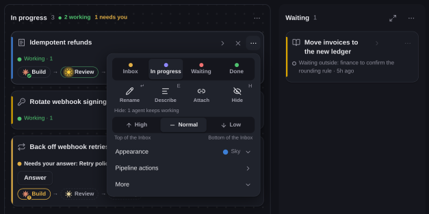

# A tour of the interface

This page walks through the screens you work in, one piece at a time: the
board, the **Needs you** panel, a card's ⋯ menu, the agent window, the sidebar,
conversations and the composer. For the ideas behind them, read
[Core concepts](concepts.md); for the things you do every day, read
[Everyday workflows](workflows.md).

## The board

The board shows every task in a project and what it is waiting for.

Each task is a card in one of four columns: Inbox, In progress, Waiting and
Done.

- **On the card.** Its icon and colour, the agents working on it, and each
  pipeline with its stages and pull request. A state line under the title says
  whether the task is moving, waiting or stopped; the status menu sets the
  reason for a wait, such as your decision, another task or a usage limit.
- **Status note.** Up to 280 characters, written by an agent, the orchestrator
  or a parked pipeline, saying what is happening now.
- **Order.** Inside a column the cards with the newest agent work come first.
  A task can be high, normal or low priority; in the Inbox, cards worked in the
  last three days stand above that queue.
- **Timeline.** A card is closed by default; opened, it shows a timeline of the
  task's events. **Images** on a card opens every screenshot and render its
  agents made.
- **Undo.** Ctrl+Z undoes your own moves, edits and hides on the board, and
  Ctrl+Shift+Z redoes them.

**Ask** on a card puts that task above the orchestrator's composer as a
chip, so your next message is about it. On a phone the button is on the
task's screen.

When the orchestrator starts a pipeline, launches a stage, creates a task or
moves one, a wire runs from the orchestrator to that card for about a minute
and then fades. Point at a wire to see its task's title, and click it to go
to the card. At rest the board draws nothing.

## Needs you

When a task needs you, its card's state line says why and shows **Answer**.
It can be a question from an agent, a plan to approve, a permission prompt, a
message that did not arrive, or a stage waiting on your decision. A stop the
project's orchestrator can handle goes to it first, and the card says so; the
manual answers, such as skip and retry, are in the card's ⋯.

- **The counter.** **Needs you** at the top of the board counts what waits
  across all projects.
- **The panel.** It lists each item by project, with the waiting agent's role,
  and lets you dismiss an item or answer a permission prompt in place.
- **What it holds.** Only what waits on you. What a rule or the orchestrator
  settled goes to the Reports log as a completed line.
- **Done.** This section lists what finished in the last seven days (landed
  pull requests, deploys, incidents, limits that came back) until you accept
  each item.
- **The filter.** While something waits, the **Needs you** filter beside the
  search (or the F key) dims every card that does not wait on you.

## A card's ⋯ menu

A card's ⋯ is a compact menu. The four columns stand in one row with the
current one marked, and four icon actions rename the task, describe it,
attach a pull request or issue, or hide it; a line under them says what
hiding leaves running. The three priorities follow in one row. **Appearance**
(colour and icon) and **More** (the waiting reason, collapse) open in place,
and **Pipeline actions** opens as a page with a back row. A column's ⋯, a
conversation's ⋯ and the board's ⋯ follow the same layout, and the board's ⋯
keeps merging and the orchestrator's switches on pages of their own.

## The board header and the Overview

The Overview board shows what is running across all projects, and when a
conversation changes it redraws only that project's part, so it stays
responsive across hundreds of projects. You can also
add tasks and start agents on them yourself, from **+** in the board's
header. The header is one row: find with its filter, **+**, the orchestrator
panel, recent agents under an icon, ⋯ and **Needs you**. Tasks the board does
not draw are under **Hidden** in ⋯.

## The agent window

An agent you open, from a stage, a conversation row or a link, opens in one
window over the board, and the board keeps its layout. The window lists
every open agent on its left: click a row to read it, or press Alt+J and
Alt+K to step between them. Esc closes the window and a pill in the header
brings it back. The orchestrator's expand button opens it in the same
window.

## The sidebar

The left sidebar is one panel. Pinned projects come first, then the rest,
then an Archive fold, each section with its count. A project takes one row:
its name, how many items wait on you, how many agents are working and how
long ago something last happened; "working" counts agents whose turn is
running right now, the same rule the board uses. Below the list, a compact
system block gives one line each to free memory and swap, every account with
what is left of its weekly limit, Copilot and Telegram. **All
windows** in the block's header adds each account's plan and every window
with its reset time. When a disk runs low, a "Disk" line shows its free
space and names what takes the most room, and new lanes wait while it is
critically low.

## Conversations

Delegatus shows every agent conversation on your machine as a readable chat,
whoever started it.

On start it reads the transcripts already in `~/.claude`, `~/.codex` and
`~/.copilot`, so your existing sessions show up right away. That covers
Claude Code sessions and their subagents, Codex rollouts and their
background shell tasks, and Copilot sessions.

Each tool call is a card. An edit shows as a diff, a command shows with its
output, and an image the agent looked at shows as a thumbnail you can open
full size. In the preview the wheel zooms about the cursor and a drag pans;
on a phone two fingers zoom and one pans, and a sideways swipe steps to the
next picture. A summary line groups the calls ("wrote 1 file · patched 1
file · ran 1 command"); expand it to see each one. Next to a call's duration, such as
`352ms · 12.4k`, a number shows how many context tokens its result added, in
four colour bands from quiet under 1 000 to red from 20 000. New output streams in live, and
every conversation has its own link. Press `/` to search your messages
across every project, engine and account, or switch the search to
everything the agents wrote too.

A card reads *working* while the agent is mid-turn and *done* once its final
answer lands, so you can tell a busy agent from one waiting for you. When an
agent stops on a question, you see the question with its options, and your
answer goes straight back to the agent.

A row above the composer steps between your own messages (**Previous mine**,
**Next mine**, or Alt+Up and Alt+Down), passing over wakes, notices and
relays. When Delegatus cannot confirm that a message you sent arrived, a
compact card above the composer says so and offers **Retry** and
**Discard**.

## Start and talk to an agent

Start a Claude Code, Codex or GitHub Copilot agent from a task or from **+**
in the board's header. The form is the composer itself: pick the engine, model
and reasoning in its runtime pill, type or dictate, and send; the pane then
becomes the conversation.

- **What you can send.** Messages, images and files from the same composer. A
  message too long for the engine goes as a `message.txt` attachment.
- **Switch a running stage.** In the conversation of a running pipeline stage,
  the runtime pill switches the stage itself to another model, effort, speed or
  account.
- **Layout.** The transcript keeps at least 60% of its column.
- **While the agent works.** **Stop** stands beside **Send**, and interrupt,
  compact, re-check and **Copy terminal command** are under **More actions**.
- **Codex context.** In a Codex conversation, the composer's **Context**
  toggle sends the draft into the running turn as context: Auto follows the
  turn, and a press overrides it for that card.
- **Service tier.** A Codex agent can run on a service tier you set per launch,
  stage or role.
- **Tools.** Agents use the bundled [MCP server](mcp.md) to reach the board,
  tasks, pipelines and each other's conversations. The orchestrator does its
  work through the same server.

## Activity

The **Activity** page, at the top of the sidebar's ⋯ menu, shows your time and your agents'
time, per day and per project. On a team install it counts each member's
own time; the owner can also filter by member or add everyone up.

## Where to go next

- [Everyday workflows](workflows.md#read-the-board) shows how to use the board
  day to day, and [the orchestrator in depth](orchestrator.md) covers the panel
  you talk to.
- [Accounts, limits and roles](accounts-and-roles.md) covers the account chips
  in the composer and the sidebar's limits.
- [From your phone](phone.md) covers where the phone layout differs.
