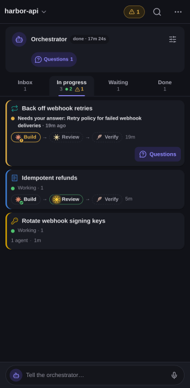
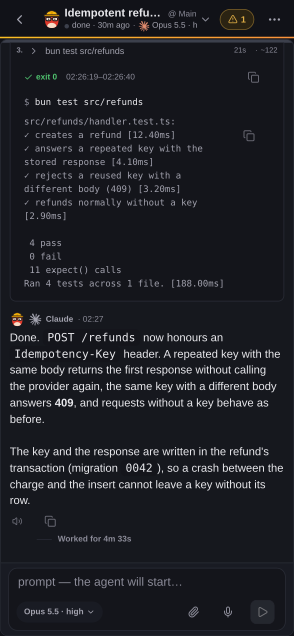

# From your phone

Delegatus has a layout built for a small screen, and a way to reach your
install from a phone through your Tailscale network. This page covers the
layout, push notifications and the access setup.

## The phone layout

The board's four columns become tabs you swipe between. Cards that need you
come first, and each card starts with its task's icon in the task's colour.
Hold a card and it lifts with a dock of the four columns: let go over one to
move the task, or in place for the card's menu, where you hide or dismiss
it. The Overview works the same way across every project.

A task, a pipeline or a conversation opens full screen. A pipeline shows its
list of stages, and you answer a decision inside the stage that stopped on
it. A conversation keeps the composer at the bottom. Back returns to the
screen you came from. Accounts and limits are in the board's ⋯ menu.

Turn on push notifications to hear when an agent asks you a question. When
an agent asks for your attention, the phone shows a quiet notice and leaves
your screen where it is. [Phone access](#phone-access) explains how to reach
Delegatus from your phone.

<p align="center">
  
  
</p>

The board on a phone, and a conversation with its test run expanded.

## Phone access

Phone access lets you open Delegatus on your phone through your
[Tailscale](https://tailscale.com) network.

Open the setup guide (the sidebar's ⋯ menu → **Help and learning** →
**Setup guide**, or the board's ⋯ menu on a phone) and go to **Phone**. If Tailscale is signed in on this
computer, press **Turn on phone access**. Delegatus publishes itself inside
your tailnet with `tailscale serve --bg`, protects the page with an access
key and shows you the link and its QR code. Nothing restarts. Delegatus
remembers the choice in `~/.config/delegatus/phone-access` and publishes
again on the next start. **Turn off phone access** removes the mapping and
forgets the choice. If Tailscale is missing, signed out or has no MagicDNS
name, the step tells you which one in a sentence with a link, and notices
when you fix it.

To do the same from a terminal:

```bash
bunx delegatus-cli --tailscale
```

The server stays bound to `127.0.0.1` either way, and Tailscale publishes it
only inside your tailnet. Delegatus never uses Tailscale Funnel, which
would expose it to the public internet. The terminal prints the tailnet URL
with a QR code, and **Open on phone** in the sidebar's ⋯ menu shows the same
QR code. The
URL carries a 32-character access key. After your first visit the server
sets a cookie that lasts 30 days. `--new-token` makes a new key and
invalidates every older key and cookie. Once phone access is on, every
browser, including the ones on this computer, needs to open the link once.

Publishing needs Tailscale's operator right. If the button says it is
missing, run `sudo tailscale set --operator=$USER` once and press the button
again.

Treat the tailnet URL as a secret: anyone who has it can read every
transcript and run commands through Delegatus.

[Security and privacy](security-and-privacy.md#security) covers what else
reaching Delegatus means.
