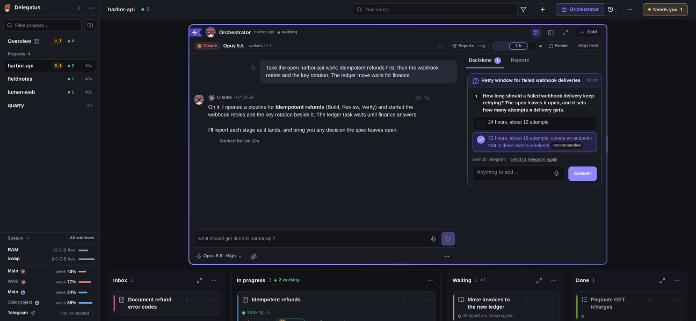

# Telegram and the chat relay

Delegatus connects to Telegram in two ways, and can answer questions from a
relay service's chats. This page covers the bot, your own account, what happens
when Telegram is down, and the external relay.

Both Telegram connections live behind the **Telegram** line in the sidebar's
system block.

## The bot

Paste a bot token from @BotFather and choose which chats agents may post to.
Agents post to those chats and read what the bot receives through the MCP
server.

- **Photos.** One photo or an album of up to ten (JPEG or PNG, each up to
  10 MB), with a caption for each image.
- **Report files.** Up to 20 MB (Markdown, text, log, JSON, CSV, HTML, PDF or
  an image).
- **Where files come from.** Only from the **Document folders** set in the
  panel, `handoff/` in your home by default. A text file holding a password or
  a key is refused.
- **Reports.** The orchestrator can send its reports to one of these chats.
  When the installation's owner replies to a report there, the reply goes to
  that project's orchestrator.

## Your own account

Enter your `api_id` and `api_hash` from
my.telegram.org, then scan a QR code with the Telegram app. Delegatus
registers a read-only Telegram MCP server, named `telegram`, for Claude
Code and Codex, so your agents can read your chats and cannot write to
them. The session stays on this machine. The same panel can have an agent
write a daily report on the chats you pick.

## When Telegram is down

Telegram never stops an agent from starting. If the connection is only down,
the start reconnects it, waiting at most twenty seconds. If Telegram was
never set up or you signed out, agents start without the Telegram tool and
nothing asks you. If Telegram needs you, the agent starts without the tool,
and the orchestrator's seat shows one line with what to do; the tool returns
on the next start after you reconnect.

## External relay

A relay service can send this install questions from its own chats. The
install asks the service for work, so nothing reaches it from outside.

### Pair

Open **Chat relay**, under **Settings** in the sidebar's ⋯ menu (the board's ⋯
menu on a phone), or the **Relay service** step of the setup guide, to pair the
two. **Connect Celestia** pairs with that service in one click. The card shows
each relay's state and, for each target, the engine, model and effort it
answers with.

### How a question is answered

- **Who answers.** A one-shot agent on your signed-in Claude or Codex account,
  with no shell, no tools and none of your instruction files.
- **What comes with a question.** Who asked it and their rights in the chat, a
  short memory of the chat and an index of the service's own tools. When one of
  those tools fits better, the agent hands the question back to the service.
- **Service tools.** When the service offers its tools with a question, the
  agent can read with them and, for a requester who is allowed to, perform one
  action at a time.
- **History.** Answers are kept for 30 days.
- **Polling.** The install picks up new service features every five minutes,
  whatever the owner tools switch says, and acknowledges a question as soon as
  it takes it.

### Owner tools

- **Full agent for the owner**, off by default on each target, runs the relay
  owner's requests as ordinary Delegatus agents with full access to this
  computer. These turns use the target's time cap, even after the service's
  request window closes. A late answer arrives as a new text message replying
  to your original message in the same topic. Files are omitted with a note.
  Delivery requires the service's owner delivery context and clone send route;
  an unavailable route keeps the answer saved for retry. Missing delivery
  context keeps it saved as pending. An interrupted owner turn is retried once
  after startup.
- When the service offers them, the card can create a new clone.
- A published prototype review goes to the paired owner's private chat, where a
  reply records the decision.
- Reading the owner's group history through `relay_owner_history` stays behind
  the owner tools switch, off by default.

### When the install is busy

When the target, the chat or the install is busy, a question waits instead of
failing: it is acknowledged, the service sees the `queued` step if it shows
steps, and it starts once room opens.

A question that waits is not lost. An answer that has already started keeps
running and may arrive late, and member quotas and accounts with no room answer
at once. The timings are in the protocol.

The protocol is in [docs/design/relay.md](../design/relay.md).

### Prototype reviews to the relay owner's Telegram

With a relay clone paired, a published review also goes to the owner's
Telegram as carousels, one per variant. A round over Telegram's limits goes
as a compact preview with a link to the full review. A failed or unconfirmed
post stays on the review with its reason and reaches the orchestrator on its
next wake. **Send to Telegram again**, in the review's actions, sends any
round again, older ones included.

Each question also appears as a native poll beneath the form. Options keep
their question number and letter (`1a`, `1b`), and ✅ marks the recommendation.
Questions that allow several choices use multiple-answer polls. A custom-answer
hint points to a text reply; full wording stays in the form when a poll is shortened.

The owner's text reply to the form or any of its polls records the decision:
`1b, 2a`, `1: b`, `рекомендовані`, or a comment. An ambiguous reply receives one
clarification request. Votes show participants' opinions. A board answer leaves
the polls in place. Poll failures are recorded on the round and reported to the
orchestrator; the form remains published.
