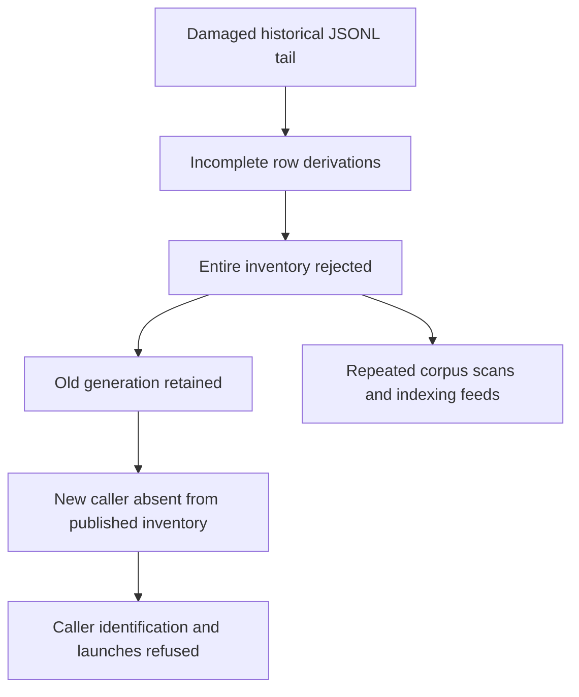

# Scanner convergence and retained history

Two damaged historical transcripts repeatedly prevented the local installation
from completing its file inventory. Active transcripts also changed between
discovery and hydration. These failures kept the published generation at zero
while requests advanced its target beyond 2,300, and blocked caller discovery.

The serving release was `8f1cfd53081315f07780328c46e0d9c2278a153e`.
The repair starts from `3a8128ce615597496c647a18358830a0a27bd0e6`.
The original checkout and its untracked work were preserved; changes use a
separate worktree. Transcripts and live state were read without modification.

## Observations

An eight-second process sample measured 130.7% CPU in the web process, 7,371 MiB
RSS and 1,574 MiB swap. The inventory worker held 2,136 MiB RSS and 605 MiB swap
in that sample; an earlier observation found its RSS above four GB. The runtime
host was a separate process. The system had about 2.3 GiB available memory and
25 GiB swap occupied at the initial observation.

An ordinary `/api/files` request returned 13,636,863 bytes in 12.664 seconds.
A later summary request took 10.955 seconds and still reported published
generation `0`, target generation `2342`. Logs repeatedly reported
`filesystem scan incomplete` and controller scan deadlines.

Header derivation over 10,145 catalogued files completed with zero failures.
An additional 2,342 changed or uncatalogued paths also had readable metadata.
The full scanner, run against the installation's transcript roots with all
state and account configuration isolated, returned 301 files and
`complete=false`. Four selected files had incomplete derivations:

- Two actively growing Codex files became readable when their current size and
  modification time were used.
- One unchanged Claude transcript contained several malformed interior JSON
  lines in its tail.
- One unchanged Codex transcript contained malformed interior lines and a torn
  final JSON string.

The files and their original contents remain untouched. Their identities and
raw diagnostics are retained outside the public repository.
The isolated reproduction exercises scanner convergence; it does not replay the
operator's registry, seats or rendered board.

## Failure path

`tailRecordsResult()` correctly refused uncertain turn evidence, but it gave
content corruption, changing identity and I/O failure the same result. The
scanner then required every selected row's derivations to complete before
publishing any inventory. A stable damaged file could therefore invalidate
the whole generation indefinitely.

The repair preserves unknown turn evidence on a damaged row and its presence
in the completed inventory. Filesystem, header and I/O failures continue to
withhold an uncertain generation. No damaged tail can prove terminal or idle
state. Inventory reconciliation retains an existing busy turn when the tail
is unavailable.

Hydration reobserves each file's identity. A changed file's current header must
agree on cwd, engine, format, kind and native lineage before its observation is
updated. A change during hydration gets one bounded retry. Different catalog
identity still requires another discovery generation.

Completed polls reuse the resulting generation. A repaired tail can become
authoritative on a later fresh observation. Scanner diagnostics name up to five
unavailable tails while retaining their unknown evidence.

## Warm-start read amplification

Snapshot priming wrote context usage into `ctx-v2` with a three-field tuple.
The real reader uses `ctx-v3` with a fourth field, the launch model used to
resolve Claude capacity. Consequently, unchanged transcripts reopened their
128 KiB tails after a warm restart.

Context priming now runs through the context reader's own helper and includes
the model. Legacy usage shapes are left unprimed. The existing real restart
tests failed on the baseline with one extra read / 131,072 bytes and pass after
the repair with zero transcript reads.

## Verification and limits

On the initial source, the new damaged-tail and concurrent-append regressions
failed through the actual scanner and scan cache. They pass after the repair.
Another regression performs twenty ordinary polls with one actual scan,
retains the damaged row and verifies convergence after repair.

Explicit-path isolated checks passed under Bun 1.4.0:

- Scanner integrity: 4 tests.
- Activity and strict stable-tail reading: 28 tests.
- Real scan cache, restart, EIO and prefix bounds: 19 tests.
- Context usage: 12 tests.
- Scanner worker transport: 11 tests.
- Migration turn authority: 24 tests.

The source candidate also completed a read of the real transcript corpus with
`complete=true`, retaining the two damaged rows with incomplete derivations.
This proves inventory convergence. It does not measure a deployed reduction in
steady-state web RSS or CPU. The earlier
[pipeline admission and activity-ingest repair](viewer-load-stall-2026-10-13.md)
addresses separate history-reader costs and was already merged into the repair's
base. The local installation still served the older release during this work.

Local whole-project type checking exceeded the chosen memory/time bounds.
Hosted type checking remains required before merge. No live restart,
deployment, agent signal or transcript cleanup was performed.
