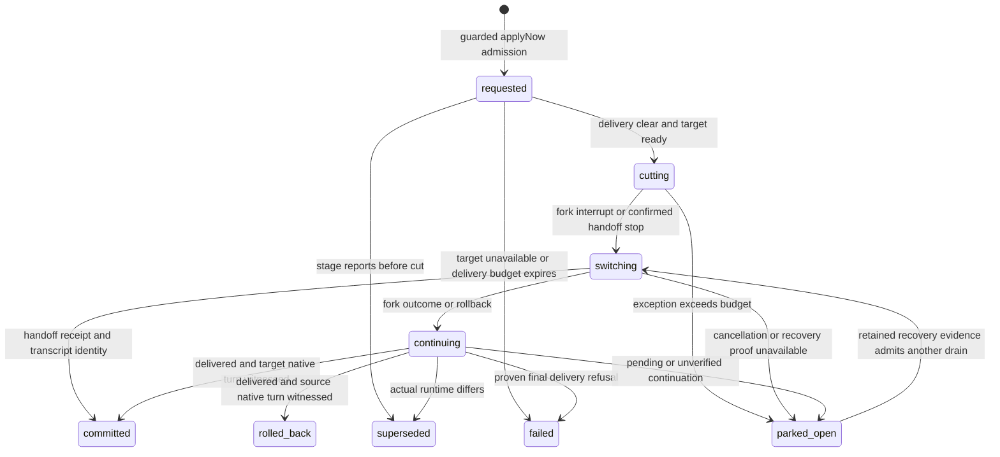

# Runtime switches that strand a stage

Audit date: 2026-10-15. Source: current main
`45d25ac796d5824713c9fb57d65f57efea61041b`, also the lane's starting commit.
`git ls-remote origin refs/heads/main` returned that SHA during this audit.
The incident deployment was `ba6ae835ced5fcd2ffae8b220f51618c3ad50dd4`.
This document is the only worktree change. No runtime action, commit, staging,
push, restart, permission change, or production test was performed.

The defect remains on main. A same-engine switch always enters the live
conversation fork path, even when the source host has disappeared or the
attempt is waiting for provider capacity. Its failure handler changes the
pipeline and attempt to `needs_decision` without settling the switch, setting
a verdict, or setting `completedAt`. Retry rejects every open switch;
decision resolution requires a settled `needs_decision` verdict. Ordinary
attempt recovery yields to the switch. These rules create the dead end.

There were two failure mechanisms in the three October 13 lanes. Two could
not interrupt their source. The third reached account migration, which failed
the target transcript-directory safety check, then waited for its rollback
continuation. The earlier fix, PR #2734, addressed a paused Codex native queue
and proven continuation refusal. It retained the open-switch fence for
unresolved delivery and did not add fresh-attempt recovery for these cases.

## Evidence and reconstruction

Evidence identifiers below refer to the command/query ledger at the end.
Account A means the exhausted source; account B means the explicitly selected
target. Account names, account IDs, transcript home paths and raw payloads are
withheld from this public document. Subscription tiers were not needed for
this investigation and were not established. All times are UTC. [E1–E6]

| Time on 2026-10-13 | Observation |
| --- | --- |
| 02:04:39.323–02:08:48.371 | The retained checkout deployment record names `ba6ae835…`, ending `succeeded`. The service journal shows startup at 02:08:45.623 and restart-cut obligations, including `12f5e76a/build/1` at 02:08:45.709871. The journal's emitting launcher PID stays the same; a systemd main-PID change is not required for this release transition. [E3, E4] |
| 02:08:47.896 / 02:08:48.071 | Archived `ac866f68/build/1` and `ce4e44b1/build/1` entered usage-limit waits on A, with `tries:0` and resume time October 18 04:22:18. [E1] |
| 02:10:40.861–02:11:18.432 | `12f5e76a/build/1` ended after the restart; attempt 2 started at 02:10:49.629, then entered a usage-limit wait at 02:11:18.432, initially due at 02:41:18.432. [E1] |
| 02:17:22.063 / 02:17:25.565 / 02:17:31.559 | Guarded `override-stage` requests with `account:B, applyNow:true` were accepted for the three builds, respectively. All recorded `mode:fork`, `phase:requested`, preserving Codex/Astra/xhigh/priority. Future definitions were changed to B. Attempt numbers remained 1, 1 and 2. [E1, E2] |
| 02:17:34.045–02:17:35 | Contemporary stage reads show `ac866f68` already `cutting`, with the other requests still recorded as requested. Acceptance did not establish a successful account move. [E2] |
| 02:17:47.908 | `12f5e76a` persisted its `…-continue` dispatch key. [E1, E2] |
| 02:17:49.069618 | Journal `delivery.reconfigure` names that lane's derived `…-reconfigure` operation. At 02:17:50.920191 a `delivery.admit` wait is logged, but that line alone does not prove the send's outcome. [E3] |
| 02:17:53.560009 | The journal explicitly names attempt 2's conversation in `recoverable successor provider failure`, engine Codex, phase `successor-starting`, with `target transcript root failed safety checks`. [E3] |
| 02:21:24.413862–02:21:24.514755 | Four runtime-host client requests time out: two `effect-batch`, one `append`, one `wait`, approximately 29 seconds each. Ten pipeline-phase deadline messages occur in 02:17–02:31; pipeline SQLite lease failures occur at 02:24:47 and 02:28:38. These show concurrent infrastructure delay; they do not identify the failed switch operation or explain its permanent fence. [E3] |
| 02:25:18.452 | `ac866f68` remains running with switch phase `cutting`. The 02:25:21.895 activity response positively identifies `12f5e76a/build/2` as verified idle/waiting. Its live-only response does not prove when either other host died. [E2] |
| 02:25:29.363 / 02:25:31.057 | Retry requests for the first two lanes are refused because their switches remain unresolved. [E2] |
| 02:28:58.295 | The seat's recorded wake lists both control-unavailable failures and the pending-continuation failure as needing attention. [E2] |
| 02:29:02.211 / 02:29:03.558 / 02:29:06.492 | All three retries return `the runtime switch for this attempt is still unresolved; wait for its continuation and runtime outcome before retrying`. [E2] |
| 02:29:08.663–02:29:09.486 | Stage reads show `ac866f68` and `ce4e44b1` parked in `cutting`, outcome `stage stopped mid-turn; runtime switch could not complete: Error: structured control unavailable`. `12f5e76a` is parked in `continuing`, `rollback:true`, with `stage stopped mid-turn; runtime switch continuation delivery is still pending`. All three have null verdict and completion time. [E2] |
| 02:29:15.167 / 02:29:17.976 / 02:29:20.496 | Decision resolution is refused on all three: `resolve-decision requires a run attempt settled with a needs_decision verdict`. [E2] |
| After the investigation window | Archives retain one build attempt in each first lane and two in the third. Closing at 06:24:33.777, 06:24:34.646 and 07:09:37.377 superseded the switches as `pipeline closed`. Close preserved seven uncommitted paths in the first checkout and one in the third. Those final records overwrite the original switch outcome and provider-wait error, so they cannot alone reconstruct 02:29. [E1] |

The ten-minute switch budgets expired at approximately 02:27:22, 02:27:25 and
02:27:31. The first retained parked observations bound the transition; they
are not exact park timestamps. The seat contemporaneously attributed the
first two lost hosts to the 02:08 release restart. Their exact process death
times and the precise null-return branch of `dispatchStructuredControl` are
not retained in the queried evidence. The independent evidence proves the
unavailable control channel, usage waits, and subsequent deadlock. [E1–E4]

The third failure has a concrete lower-level source:
`src/lib/accounts/migration/provider.ts:1439` resolves the target and calls
`ensureTargetRoot`; `:1375` checks the sessions directory and `:1377` emits
the exact journal error. `src/lib/accounts/migration/coordinator.ts:1193`
logs it and `:1206` records `failed-recoverable`. A read-only metadata probe
on this installation, through the journal launcher's process root and in the
same mount namespace/UID, found B's home mode `0700`, sessions mode `0775`,
both owned directories and neither a symlink. The current predicate rejects
the sessions directory's group-write bit. This independently reproduces the
predicate today; it does not recover historical mode metadata. No permission
repair or relaxation is proposed here. A fresh attempt avoids the history
migration path, while normal launch validation must still apply. [E6]

The retained runtime SQLite journal has no operation rows for the three
conversations. Its retained event range began on October 15, after the
incident. Consequently the precise migration receipt, rollback acceptance,
and eventual send disposition cannot be recovered from that database. The
02:17:53 migration error and 02:29 pending rollback are independently recorded.
No missing credential or additional live request would recreate compacted
history. [E5]

## What the earlier fix covered

The archived lane `382e57dd` and its originating task date the original seven
tier changes to October 10 22:36–22:38, with later observations around the
23:03 report in the brief. The affected lanes were `e153d423`, `c9a686d9`,
`98d17892`, `9f51f449`, `9c1b4eea`, `76e43593`, and `b897a495`. Their fork
switches reported `reconfigureNoop:true`; the interrupted native queue accepted
the continuation but never started its turn. Repeated admissions rearmed the
same held delivery, raising its attempts counter to 20 and shifting the
settlement window. Twenty was not a retry limit. The archived diagnosis
reports two real Codex reproductions and distinguishes fresh idle admission
from interrupt-then-idle. This audit read that diagnosis; it did not rerun that
historical native experiment. [E7]

PR #2734 landed as `462b38ddcc34854ae4cc80dcb11663cc41dc6097` at
2026-10-11 11:35:49Z, before `ba6ae835`. First-parent history and an ancestry
check confirm inclusion. The resulting code remains in current main: [E8]

- `runtimeSwitch.ts:159` stops readmitting an already-owned continuation key.
- `:165` uses managed Codex `steer-or-queue` with explicit `turnId:null`;
  this waits for idle and starts a new turn, preserving other queued entries.
- `:43` treats receipt-free `reconfigureNoop` as applied.
- `:173` distinguishes proven pre-admission refusal from uncertainty.
- `:392` permits one replacement after proven send failure and a terminal
  runtime outcome; `:414` closes proven admission refusal when the fork's
  reconfigure is applied, superseded or failed.

That fix deliberately left unknown admission/delivery fenced. It does not
handle a failed interrupt before reconfigure admission; an accepted rollback
that remains pending also does not satisfy its proven-refusal conditions.
`git diff ba6ae835 HEAD -- src/lib/pipelines/runtimeSwitch.ts` is empty.
Current tests even assert that a dead-host attempt with an open switch rejects
retry (`runtimeSwitch.test.ts:701`), and that a parked unresolved continuation
survives restart without allowing retry (`:678`). Those expectations preserve
duplicate-execution safety but do not satisfy this task's recovery contract.

## Current state machine

Line numbers below are against the pinned main SHA. `R` means
`src/lib/pipelines/runtimeSwitch.ts`; `E` means `src/lib/pipelines/engine.ts`.
The persisted union is `src/lib/pipelines/types.ts:355`. [E8]



`parked_open` is the composition of pipeline/attempt `needs_decision` and an
unchanged open switch phase; it is not a separate stored switch phase.

| Boundary | Current behavior and source |
| --- | --- |
| Admission | E:12876 checks authority and expected attempt/conversation. E:12888 requires stored running structured state and identities; it does not prove source liveness. E:13013 excludes known exhausted targets. E:13023 replays the same open target or refuses another. E:13042 chooses `fork` solely by engine equality, otherwise `handoff`. |
| Ownership | E:6329 drains outside the shared collection lease under one switch lock. E:6354 checkpoints attempt/control identity; E:6366 rechecks kills and account authorization before side effects. E:10078 runs this drain separately from ordinary stage ticks. |
| Ordinary recovery | E:6520 returns while a switch is open, except a pre-cut final report. Other recovery/adoption paths also exclude open switches at E:4987, E:8072, E:8215 and E:8767. Provider wait does not independently rescue a switch. |
| Requested | R:217–226 checks target pool, outstanding delivery and engine readiness, then persists `cutting`. There is no source-dead/provider-wait strategy selection. |
| Cutting | R:228 interrupts the source for `fork`; R:234 stops the source for `handoff`, accepting only stopped/not-running. Production controls at E:1882 call `dispatchStructuredControl`; its `structuredControls.ts:274–303` null returns include missing conversation/generation/entry and missing structured ownership. R:35 converts null to `structured control unavailable`. |
| Fork switching | R:248 issues reconfigure, queues continuation before reading its outcome, then waits, cancels/rolls back after expiry, or enters continuing. E:1899 maps absent/unreadable outcome evidence to pending. |
| Handoff switching | R:290 prepares a durable handoff and stable launch identity in the same attempt. It records reservation before acknowledgement, reconciles receipts, and only commits after session/path publication. This existing mode also preserves the attempt number; it does not implement the requested fresh attempt. |
| Continuing | R:366 requires delivery, generation, account authorization and native turn-start evidence after the dispatch boundary. R:114 clears provider/recovery waits only on success. R:193 rollback returns to the source and can reuse an already-admitted key, including a source still limited by its provider. |
| Park and settlement | R:135 settles only the switch. R:140 parks pipeline/attempt and writes outcome, leaving phase, verdict and completion unchanged. The dispatcher has parallel open-phase parks at E:6377 and E:6393. |
| Parked reconciliation | E:6337 excludes parked requested switches. E:6418–6467 gates entry by terminal reconfigure/delivery/receipt/generation/account evidence. E:6491 returns the lane to running only for committed/rolled-back, excluding superseded. |
| Operator recovery | E:12651 unconditionally refuses retry with any open switch. E:11739 requires a settled needs-decision verdict for decision resolution. E:13378 also fences stage reports after the cut unless verified continuation evidence identifies the reporter. |

## Exhaustive switch-stranding paths

This inventory covers open-phase exits and pre-driver gates in R and
`drainRuntimeSwitches`, plus terminal outcomes that leave inconsistent attempt
state. Ordinary authorization, stale-request, publication, and survivor guards
remain separate safety checks. Every open phase matches R:39 and therefore
E:12651. The main loop cannot use a null verdict to resolve a decision. [E8]

| Path | Source | How progress and retry remain blocked |
| --- | --- | --- |
| Dead or unavailable control; failed interrupt/reconfigure; transport/kill-history/read exception | R:231, :250, :212, :412–423 | Generic exception retains cutting/switching/continuing; at ten minutes it parks without terminalizing. Includes missing continuation port/path/identity at :154 and handoff input/artifact/persistence exceptions at :293–323. This is the first two incident lanes. |
| Proven refusal without a terminal fork outcome, or refusal during handoff rollback | R:173–176, :414–423 | Special settlement applies only to fork plus terminal outcome. Other refusal falls into the generic open-phase park. An exception while rereading outcome inside the catch can escape the driver entirely. |
| Pending reconfigure cannot be cancelled | R:256–262; :102–112 | Cancellation missing, already applying, already settled, unknown conversation or stale migration ownership leaves switching open. Cancellation is not a general revocation: registry :8724 can rearm held messages on the source. |
| Source authorization missing/revoked | R:141–147, :197, :272, :281 | Rollback parks before completing. Repeated authorization failure has no terminal recovery transition. |
| Target/actual account revoked, or authorization read fails at dispatch | E:6377–6394; R:373–376 | A checkpoint parks and throws `RuntimeSwitchSuperseded` while phase stays open; even successful cancellation there does not finish the attempt. Parked requested records are excluded by E:6337. |
| Uncertain prior or failed continuation | R:198–200, :267–269, :398–399 | `duplicateRisk` correctly prevents replacement, but leaves no durable retry/revocation request the operator can advance. |
| Failed reconfigure plus delivered source continuation, but source generation unconfirmed | R:271–279 | Immediate park at :275, or native-start wait at :277. A delivered receipt alone cannot establish safe continuation. |
| Unconfirmed source stop during handoff | R:234–241 | Cutting persists and parks at expiry. Later confirmed stop can recover; permanently unavailable proof strands it. |
| Missing/incomplete/failed handoff launch receipt, successor stop unconfirmed | R:325–339 | Missing receipt or failed staged launch requires stop proof before rollback; absent proof parks. Parked handoff requires a retained completed/failed receipt at E:6453–6457, so a still-missing receipt cannot reach that cleanup again. |
| Spawn exception after reservation, or completed receipt missing transcript/session | R:350–357 | Reserved launch is reconciled on later ticks. A permanently missing identity on a completed receipt simply schedules another tick with no expiry check at :357, leaving switching open forever. |
| Rollback send remains pending | R:193–209, :409 | Source identity and waits remain; timeout parks continuing. This is the third incident lane. Parked handoff rollback at E:6443–6451 accepts only delivered source continuation; even proven failed delivery is skipped there. |
| Delivered continuation lacks generation or fresh native start | R:179–191, :369–378 | Missing generation or stale/missing native start parks after expiry. A null pathname returns immediately at :181 without the expiry park. None completes the switch. |
| Failed send waits on missing/pending reconfigure outcome | R:392–408 | Replacement is forbidden until the runtime operation settles. Parked fork gate at E:6420–6426 also demands terminal outcome, so an absent receipt cannot recover. |
| Parked delivery remains pending, or generation differs | E:6420–6430 | The drain is skipped before it can retry cancellation, failure handling or expiry. Outcome/delivery reads that throw here escape the driver and leave the record unchanged. For delivered superseded runtime, strict expected-target comparison can prevent the driver's normal superseded outcome. |
| Parked account checks fail | E:6459–6466 | Reconciliation silently skips; no new reason, failure settlement or retry admission is recorded. |
| Paused/draining/unpublished controller, or executor lock unavailable | E:6332–6345 | The driver waits outside its deadline logic. These may be temporary operational holds, but elapsed switch budget alone does not settle them. Retry still encounters the open-switch guard. |
| Terminal switch with incomplete attempt settlement | R:214–215, :404–418; E:6370–6372, :6491 | Proven failure/kill closes the switch and frees its specific retry guard, but park still leaves a null verdict/completion. A parked switch settled as superseded also stays parked because only committed/rolled-back reopens it. Decision resolution remains impossible; other retry guards still apply. |

Early target refusal, engine unavailability and outstanding-delivery expiry at
R:218–225 do set switch phase failed. A terminal unsuccessful handoff stop at
R:243 also settles only the switch. These paths leave the attempt running,
so running retry must still prove a stall at E:12665–12713. Closing a phase
alone therefore does not implement “a failed switch always leaves retry
admissible.” Likewise, removing E:12651 alone could start a second writer while
the old continuation or reserved successor can still execute.

## Fix design

Use one controller recovery operation for automatic source replacement and
operator retry. Keep the existing switch record as evidence and add the minimum
durable retry/recovery intent needed to own outstanding side effects. Do not
derive completion from elapsed time, an absent receipt, or a missing registry
row alone.

1. **Classify the source before cutting.** Under the existing attempt/control
   fence, collect the real source process/host disposition, provider wait and
   durable turn evidence. Extend apply-now admission to an eligible parked
   provider wait or dead attempt with a durable source identity, retaining the
   expected-attempt/conversation guards and respecting pause/close. A confirmed
   dead source or a provider-limit-waiting
   attempt chooses fresh-attempt replacement on the selected runtime. A live
   idle source can use the existing managed continuation with `turnId:null`;
   a busy source uses interrupt plus the same managed path. Recheck after each
   await. A null control response means unavailable control and needs explicit
   source disposition; it is insufficient proof that no process survives.

2. **Own the cut before creating the next attempt.** Persist recovery intent,
   selected target, old attempt identity, and all operation/launch keys.
   Invalidate the old provider retry and switch dispatch authority. Reconcile
   or durably revoke the reconfigure, managed send, native queue entry and any
   reserved successor. Confirm termination of each actual writer by its owned
   identity. A killed host must not leave a separately running CLI child.
   Reuse the runtime/registry ownership boundaries and orphan safeguards from
   current main. Cancellation that rearms a source continuation cannot serve
   as final revocation. E:6366, the runtime reconfigure executor, send consumer
   and launch publication must all observe the withdrawn recovery generation.

3. **Make retry admission independent of cleanup completion.** Replace the
   unconditional open-switch 409 with an idempotent durable retry request tied
   to the expected attempt. Accept and return its current pending/settled
   status even while external proof is unavailable. Execution waits for the
   cleanup fence; repeated clicks and Viewer restarts replay the same request.
   This satisfies always-admissible retry without allowing concurrent writers.
   Auth failures or conflicting expected identities retain their existing
   refusal semantics. If the runtime is unavailable, expose the exact pending
   obligation and last failure while continuing bounded reconciliation.

4. **Settle the whole attempt consistently.** Centralize mechanical failure
   settlement: terminal switch phase/reason/time, old attempt error and
   completion, cancelled old wait, and an explicit controller-origin verdict
   or mechanical-failure record compatible with retry. Use the existing
   `needs_decision` verdict shape when presenting a decision; do not forge an
   agent report or route the stage's failure edge accidentally. Maintain the
   invariant that every pipeline in needs-decision has a matching completed
   attempt with a non-null verdict. Pending cleanup can remain a running
   recovery operation with visible status. Keep the original failure reason
   separate from subsequent cleanup trouble.

5. **Allocate exactly one fresh attempt in place.** Once cleanup is proved,
   retain worktreeDir, branch, HEAD, index, modified tracked files and untracked
   files. Advance the same stage cursor, bind the selected runtime/account to
   attempt n+1, reserve a stable launch key, then use ordinary activation.
   Current `resetStageForRetry` at E:2426 preserves the checkout; it does not
   perform the destructive reset described in older orchestration guidance.
   Preserve the old attempt's receipts and failure history. Reuse its stage
   brief plus bounded handoff/progress context. Confirm the new launch's actual
   account, model, effort and tier. A failed fresh launch is itself retryable.

6. **Handle every failed continuation with the same recovery operation.**
   Proven pre-admission refusal can finish promptly. Unknown admission retains
   its key and obtains revocation/termination proof before replacement. Do not
   rearm an admitted message or issue a new key merely because a timer expired.
   A permanently failed target must not roll back into an exhausted source and
   wait for its quota reset. Show the failure and accept retry toward the saved
   selected target, subject to fresh authorization/readiness checks.

7. **Repair old records lazily and durably.** Reconcile legacy parked open
   switches, null-verdict attempts, missing dispatch/receipt identities,
   `reconfigureNoop`, and terminal-switch/parked-attempt combinations through
   the same operation. Include parked requested and handoff rollback failure
   cases. Preserve closed/paused operator intent and archived records. Retry
   must not resurrect a closed lane or override a newer request.

For “promptly”, the implementation should prove that known dead or limited
sources begin recovery on the next eligible controller pass and do not wait
for the ten-minute switch budget or provider reset. Every external call must
be bounded. If cleanup cannot complete, the accepted retry remains durable and
visible; a new agent must wait for exclusive worktree ownership.

Implementation seams are R, E, types/store validation, and the existing
structured control/delivery/reconfigure ownership APIs. Coordinate any shared
engine hunks with the pipeline-evidence lane and any durable writes with the
state-lock/MCP-writer lanes. The runtime-snapshot and deploy-seat-wake lanes
remain outside this change unless evidence requires a shared contract. No
parallel-lane source was edited by this audit.

## Regression matrix

Each recovery row must assert stable worktree/branch/HEAD, unchanged staged,
modified and untracked bytes, preserved old receipts, one next attempt and one
launch, correct target runtime, no concurrent writer, and replay after a fresh
engine import/process restart. Mechanical parking must always have a verdict,
completion and reason. Retry must be accepted durably before cleanup completes.

| Case | Required observation |
| --- | --- |
| Dead source after deploy; registry entry absent; retained dead entry; orphaned CLI child | Fresh attempt on B promptly after verified ownership cleanup. Null interrupt control cannot strand cutting. A surviving child prevents launch while retry remains accepted. |
| Usage-limit wait with live idle host, dead host, future reset, unknown reset | Cancel old retry ownership; start fresh attempt on B without waiting for reset or trying to continue A. Include running-wait and already-parked provider-wait admission. |
| Live idle Codex, including interrupted native queue | Existing managed next-turn continuation starts once on B; queued unrelated input is unchanged. Retain the real native regression from #2734. |
| Live busy Codex | Interrupt acknowledgement followed by terminal idle then one new turn. An earlier turn cannot absorb continuation as steer or satisfy its evidence floor. |
| Target migration fails safety/auth/fork/launch validation | Preserve exact bounded cause; no automatic return to exhausted A; retry accepted. Include the observed owned `0775` sessions root under a `0700` account home without weakening the safety check. |
| Send refused before admission, terminal failed send, failed rollback | Each becomes retryable promptly. Cover applied/failed/superseded/no-op reconfigure and missing/nonterminal outcome independently. |
| Accepted pending send; admission response lost; receipt compacted; duplicateRisk | Same durable key retained. Accepted retry revokes or reconciles every producer/consumer before n+1; a late acknowledgement cannot create a second writer. |
| Delivered send with absent path, absent generation, stale start, different generation | Bounded visible recovery; every missing witness has a retry path. Superseded parked switches do not remain null-verdict decisions. |
| Target/source account revoked or policy read fails at each await | No unauthorized dispatch. Retry intent is retained with the reason; policy recovery rechecks the current selection. |
| Handoff source stop unconfirmed; launch reserved then response lost; missing receipt; completed receipt lacking path/session | No duplicate launch; bounded cleanup and accepted retry. Cover failed and delivered source rollback separately. |
| Crash after request, interrupt, reconfigure admission, continuation admission, reservation, cleanup, attempt allocation | Replay resumes the same recovery operation; no counter/key churn and no loss of dirty files. |
| Double override, double retry, stale expected attempt, late report, operator kill/pause/close | Idempotent matching request; stale/conflicting requests refused; new control intent wins; accepted valid report never gets discarded by stale cleanup. |
| Legacy incident records | Seed cutting/null-verdict and continuing/rollback/pending shapes from the sanitized evidence; retry exits both. Include old requested park and terminal-switch/null-verdict shapes. |
| Controller publication/drain/lock hold, runtime timeout, registry read failure | Pending status states the blocker; deadline handling remains bounded after readiness returns. No busy-loop or repeated side-effect admission. |

Use the existing `src/lib/pipelines/runtimeSwitch.test.ts` for state/restart
cases, the relevant explicit cases in `engine.test.ts` for retry/decision
integration, `structuredControls.test.ts` for unavailable control,
`structuredDeliveryQueue.test.ts` for delivery fences, and
`nativeQueueHost.integration.test.ts` for actual Codex idle/active behavior.
Add ownership/revocation coverage in the existing runtime/registry test files
that the implementation changes. Replace the dead-host retry-refusal assertion
with accepted-retry plus no-premature-spawn assertions; do not simply delete it.

Tests must use isolated HOME/XDG_CONFIG_HOME/TMPDIR/LLV_STATE_DIR under `/tmp`,
closed `LLV_VIEWER_CONTROL_URL`, explicit file selection and the supplied
gate-slot wrapper. Stub launch/version/signal/CPU side effects in synthetic
fixtures. A runtime-host change also requires
`bun scripts/verify-runtime-host.ts --runtime <pinned-bun>` in isolation and
connection error handlers installed before writes, as AGENTS.md requires.
Publication later requires the project's local gates and required CI including
`bun-runtime`/the configured runtime gate. This audit makes no implementation
or runtime acceptance claim.

## Command and query ledger

Production observations were collected read-only on 2026-10-15, beginning
05:14:57Z. Historical query bounds are explicit below. Commands ran through
`rtk proxy`; `nl -ba`/`sed` and `rg -n` selected the source locations cited
above. Variables describe private paths resolved in-session; their contents
are withheld here. No production GET or application import was used to obtain
stored runtime data.

- **E1 — archived pipelines:** `get_pipeline({pipelineId:id,full:true})`, once
  each for `ac866f68`, `ce4e44b1`, `12f5e76a`, `382e57dd`. Extracted graphEdits,
  attempts, providerWait, runtimeSwitches, closeReport and stageReports.
  These are final archived records, with event dates spanning October 10–13.
- **E2 — contemporaneous calls:** `conversation_messages` at the transcript
  path returned by the exact-phrase search for the incident's seat conversation
  `conversation_15093822-1d61-411c-a0c3-0fc1a159372c`,
  `since:"2026-10-13T02:17:00Z"`,
  `kinds:["message","tool_call","tool_result"]`, `limit:200`,
  `maxChars:16000` (first page 13000), following returned cursors until the
  lower bound. Selected records with `ts < "2026-10-13T02:31:00Z"` in memory.
  This recovered actual `pipeline_action`, `get_pipeline`, and activity
  responses. Useful record offsets: 1348051/1355399/1365918 admission;
  1578707/1587315/1596501 parked states; 1548042/1551514/1558778 retry refusal;
  1609367/1613696/1617949 decision refusal.
- **E3 — service journal:**
  `journalctl --user -u delegatus.service --since '2026-10-13 02:17:00 UTC' --until '2026-10-13 02:31:00 UTC' --no-pager -o json`.
  Parsed `__REALTIME_TIMESTAMP`, `_PID`, `MESSAGE`; also read
  02:07–02:31 and exact subwindows 02:08:44–02:08:47 and 02:17:45–02:17:56.
  Exact operation lookup was derived as
  `pswitch-${sha256("12f5e76a:build:2:1").slice(0,40)}-reconfigure`.
  No same-window journal line contains either first lane's ID or the control
  error string; their errors come from E2, not a journal inference.
- **E4 — deployment:** parsed the existing
  `$HOME/.config/delegatus/state/self-update/deployments.json`, selecting
  `requestedRevision == "ba6ae835ced5fcd2ffae8b220f51618c3ad50dd4"`.
  Read `phase`, `createdAt`, `updatedAt`, `revision` and owner process identity.
- **E5 — journal retention:** Python sqlite3 URI `mode=ro` and
  `PRAGMA query_only=ON` on the configured `runtime-events-<install>.sqlite`.
  `PRAGMA table_info(events)` and `PRAGMA table_info(operations)` established
  column names. Queries:
  `SELECT min(recorded_at),max(recorded_at) FROM events` returned
  `2026-10-15T00:48:42.238Z` through `2026-10-15T05:17:56.470Z`;
  `SELECT operation_id,idempotency_key,request_json,receipt_json FROM operations WHERE conversation_id IN (?,?,?)`
  used the three source conversation IDs from E1 and returned zero rows.
  The first exploratory projection asked for nonexistent `kind,status`
  columns and failed read-only; the corrected query above supplied the result.
- **E6 — directory predicate:** Python `Path.lstat()` on B's resolved account
  home and transcriptRoot, comparing `st_uid` with `os.getuid()`, mode,
  directory type and symlink type. Read `/proc/<journal-owner>/status`, compared
  `/proc/<pid>/ns/mnt` with `/proc/self/ns/mnt`, then repeated lstat through
  `/proc/<pid>/root`. Observation at approximately 05:18Z; no mkdir, chmod,
  production module import, or migration invocation.
- **E7 — prior investigation:** `get_task({taskId: oldLane.taskIds[0]})`,
  where `oldLane` is E1's `382e57dd` record; that lane's stage reports;
  `conversation_messages` using its diagnose attempt's returned agentPath,
  `roles:["assistant"],limit:6,maxChars:9000`, including final report at
  `2026-10-10T23:20:32.513Z`. Searches used project-scoped `runtime switch unresolved`
  and `"structured control unavailable"`, then unscoped `382e57dd` and
  `"reconfigureNoop"`. Broad terms were sometimes ignored by the search
  tokenizer; exact identifiers and opened records supplied the evidence.
  Memory queries `runtime switch` (project-scoped), `continuation pending retry`
  and `transcript root safety` (unscoped) found no additional verified fix.
  The live-runtime preference hit was opened by ID and checked against code;
  its liveness interpretation was treated as a hypothesis. A safety-history
  search/open concerned a different installation and supplied no evidence
  about this incident. A later remote-fixture search was checked against
  current `git.ts:52`, rather than taken as test proof.
- **E8 — source/history:**
  `git log --first-parent --format='%H %cI %s' --since=2026-10-10T00:00:00Z --until=2026-10-14T00:00:00Z`;
  `git show --stat 462b38ddcc34854ae4cc80dcb11663cc41dc6097`;
  `git merge-base --is-ancestor 462b38dd ba6ae835` (exit 0);
  `git diff ba6ae835 HEAD -- src/lib/pipelines/runtimeSwitch.ts` (empty).
  `rg -n 'runtimeSwitch|openRuntimeSwitch|retry-stage|requires a run attempt settled' src/lib/pipelines/engine.ts`
  and numbered reads of R, E, types, runtimeSwitchFence, structuredControls,
  migration provider/coordinator and the cited registry methods complete the
  state-machine inventory.

## Validation record

Validation uses a `git archive HEAD` scratch export with read-only dependencies
borrowed from an installed release after byte comparisons of package.json,
bun.lock and patches. The worktree itself receives no dependency install or
test output. The existing runtime-switch suite initially reached 6 passes and
95 fixture failures in 494 ms: its generic Git stub returns exit 0 and empty
output for `git remote get-url --push origin`, which current `git.ts:67`
correctly refuses. This happened before switch setup. A scratch-only fixture
correction returns Git's exit 2 for an absent remote. It changes no production
source and supplies no claim that the unmodified suite passed.

With that one fixture correction, the unchanged production code passed all
101 existing tests, 644 assertions, in 9.52 seconds. Three additional
scratch-only acceptance probes then failed at the intended assertions in
608 ms (16 assertions; the existing 101 were filtered out):

| Probe | Observed after the fault and restart | Failed acceptance assertion |
| --- | --- | --- |
| Dead Codex source; interrupt throws `structured control unavailable` | `needs_decision`, phase cutting, null verdict/completedAt, one original spawn, retry 409 | `expect(retry.error).toBeUndefined()` |
| Codex provider usage wait; failed migration; accepted pending continuation | `needs_decision`, phase continuing with rollback, null verdict/completedAt, old wait retained, one continuation, retry 409 | `expect(retry.error).toBeUndefined()` |
| Proven pre-admission refusal with failed reconfigure | Phase failed, retry accepted, but parked attempt still has null verdict/completedAt | `expect(attempt.verdict).not.toBeNull()` |

These are synthetic port-level tests of the real controller/store and its
restart/retry paths, without live hosts, paid model calls or filesystem
migration. The new tests use the file's `switchHarness`, with a Codex/Astra/xhigh
role, source `default`, target `target`, and a completed synthetic launch
receipt. They retain the existing fixture's inert Git, stop, spawn and turn
ports. Their critical setup is reproducible as follows:

```ts
// Scratch-only adjustment inside harness().ports.exec:
if (args[0] === "remote" && args[1] === "get-url")
  return { code: 2, stdout: "", stderr: "No such remote" };

// Dead-source probe, after admitting a same-engine account switch:
h.ports.runtimeSwitchControl = async () => {
  throw new Error("structured control unavailable");
};
h.ports.conversationTurnInterrupted = async () => "dead";

// Provider-wait probe, before admitting the switch:
attempt.providerWait = {
  condition: { kind: "usage_limit", scope: "usage", resetLabel: null,
    label: "codex usage limit" },
  text: "fixture quota exhausted", accountId: "default", tries: 0,
  turnTs: h.wallClock(), startedAt: h.ports.now(),
  resumeAt: new Date(h.wallClock() + 86400000).toISOString(), resetsAt: null,
};
h.setOutcome("failed");
h.ports.runtimeSwitchDelivery = (_id, key) =>
  h.deliveries.get(key) ?? { state: "pending", admitted: false };
h.ports.resumeSeveredTurn = async input => {
  h.continuations.push(input);
  h.deliveries.set(input.clientMessageId, { state: "pending", at: h.ports.now() });
  return true;
};

// Each of the first two probes runs a tick, advances its fake clock by
// 600001 ms, ticks again, imports a fresh engine module, ticks once more,
// then invokes retry-stage with expectedStageId and expectedAttempt.

// The third probe instead refuses before durable admission:
h.setOutcome("failed");
h.ports.runtimeSwitchDelivery = () => ({ state: "pending", admitted: false });
h.ports.resumeSeveredTurn = async input => {
  input.onRefused?.("fixture admission refused", "refused");
  return false;
};
// One tick closes the switch; inspect the parked attempt, then retry.
```

Both runs used the same export and Bun 1.4.0. Commands below use `AUDIT_ROOT`
for the owned `/tmp/runtime-switch-audit-…` directory and `GATE` for the exact
installed gate-slot script supplied to this stage. The environment assignments
apply to the test child after gate admission; the real gate owns and cleans up
its own process tree. No model CLI is available on the test PATH.

```sh
cd "$AUDIT_ROOT/checkout"
rtk proxy bash "$GATE" env \
  HOME="$AUDIT_ROOT/home" XDG_CONFIG_HOME="$AUDIT_ROOT/config" \
  TMPDIR="$AUDIT_ROOT/tmp" LLV_STATE_DIR="$AUDIT_ROOT/state" \
  LLV_VIEWER_CONTROL_URL=http://127.0.0.1:1 \
  LLV_AGENT_CPU=off LLV_CPU_PRESSURE=off PATH=/usr/bin:/bin \
  "$BUN" test src/lib/pipelines/runtimeSwitch.test.ts

# After appending the three scratch-only probes, repeat the command with:
# -t 'audit acceptance:'
```

Execution window: 2026-10-15 05:20–05:28Z, including initial admission wait
and the failed original fixture run. The required documentation privacy and
whitespace checks are recorded separately below. No product source changed;
TypeScript/build, full engine and native/runtime-host rehearsals belong to the
subsequent implementation and were not run for this document.

Documentation checks use the same isolated environment and gate wrapper:

```sh
rtk proxy bash "$GATE" env \
  HOME="$AUDIT_ROOT/home" XDG_CONFIG_HOME="$AUDIT_ROOT/config" \
  TMPDIR="$AUDIT_ROOT/tmp" LLV_STATE_DIR="$AUDIT_ROOT/state" \
  LLV_VIEWER_CONTROL_URL=http://127.0.0.1:1 \
  LLV_PRIVACY_KNOWN_VALUE_FINGERPRINTS_FILE="$WORKTREE/scripts/privacy-known-value-fingerprints.json" \
  "$BUN" scripts/privacy-publication-gate.ts --require-known-values \
  --repository "$WORKTREE" --paths docs/perf/runtime-switch-stranding.md
git diff --no-index --check /dev/null docs/perf/runtime-switch-stranding.md
git status --short --ignored
git ls-remote origin refs/heads/main
```

The first privacy run identified two opaque resource identifiers; both were
removed from this document while retaining their lookup routes. Final privacy:
pass. Whitespace: no findings (`--no-index` returns 1 for the new-file diff).
Numbered source references were checked against file lengths. Final main
remains the pinned SHA; only this document is present in worktree status, with
no ignored artifacts. Validation completed in the 05:28–05:31Z window.

## Implementation and regression coverage — 2026-10-15

The preceding sections record the diagnosis against its pinned revision.
The implementation adds durable `runtimeSwitch.retry` intent. Retry admission
stores the original reason, settles the attempt with a mechanical
`needs_decision` verdict and completion time, and withdraws the old attempt's
dispatch and reporting authority. Cleanup records its own pending reason.
Repeated requests replay that intent and retain the existing operation keys.

Dead and usage-limited sources enter this recovery on the next eligible
controller pass, including eligible already-parked attempts. Live sources
retain managed continuation. An ongoing handoff expects its source to have
stopped and keeps reconciling its reserved successor.

`runtimeSwitchRecovery.ts` withdraws unclaimed reconfigures through the registry
writer and waits for applying migrations, pending successor cleanup and host
recovery reservations. Delivery and host recovery read the durable retirement
fence before dispatch, after authorization waits and before resends. The
controller stops the recorded source and handoff successor, checks surviving
process identities and rereads producer retirement before allocation. Missing
proof leaves retry accepted with the specific cleanup obligation visible.

The cleanup completion and next-attempt allocation commit together under the
pipeline mutation lease. The next attempt binds the selected runtime, keeps
the stage input and transcript reference, and uses ordinary launch admission.
Checkout, branch, HEAD, index and working files stay in place. Pause, close,
changed stage identity and a newer kill withdraw cleanup's authority; a later
explicit retry can authorize replacement after that kill. A report accepted
before retirement survives a concurrent failed runtime read. A later agent
question after a completed switch retains ordinary decision admission;
mechanical switch parks require retry cleanup before a replacement starts.

The regression files extend the matrix above through these cases:

| File | Verified cases |
| --- | --- |
| `src/lib/pipelines/runtimeSwitch.test.ts` | Both Claude and Codex: dead/absent source, live/dead usage wait, known/unknown reset, running/parked admission. Real Git fixtures compare branch, HEAD, staged content, modified bytes and binary untracked content across recovery. Exactly one fresh attempt launches on the selected account/model/effort/tier. |
| Same switch suite | Legacy requested/cutting/switching/continuing/failed/superseded/committed parks; pending cleanup across engine reload; double retry and override; stale expectations; late report; pause/close/kill; authorization loss; recorded live child; late producer reservation; ordinary agent questions after a completed switch. A reopened registry retains reconfigure withdrawal and rejects recovery of the retired conversation, including retirement during an authorization wait. |
| Same switch suite, retained cases | Proven and uncertain continuation failure, rollback, missing delivery/generation/native-start witnesses, reserved and missing handoff receipts, failed launches, account revocation, lost acknowledgements and continuation evidence boundaries. The seven old retry-refusal expectations now assert accepted retry plus no premature replacement. |
| `src/lib/runtime/structuredDeliveryQueue.test.ts` | Retirement before drain, during journal write and before resend prevents old continuation dispatch. Existing control and delivery behavior remains covered. |
| `src/lib/accounts/migration/provider.test.ts` | Both engines reject an owned `0775` transcript root inside an owned `0700` home before reserving any successor. Directory modes remain unchanged. |
| `src/lib/pipelines/store.test.ts` | Legacy records and retry intent round-trip; invalid dates and oversized or malformed reasons are refused. |
| `src/lib/runtime/nativeQueueHost.integration.test.ts` | Real Codex idle and active runtime-switch scenarios from the earlier fix: interrupt, canonical queue dispatch, preserved input and cold recovery. |

Focused checks also run `structuredRecovery.test.ts`,
`structuredDeliveryController.test.ts`, `structuredControls.test.ts`,
`engine.recovery.test.ts`, `engine.activation.test.ts`,
`engine.settlement.test.ts`, `resolveDecision.test.ts` and
`engine.succession.test.ts`. The reset-window fixture has a bounded 30-second
test budget so its hundreds of controller passes finish before the next
fixture replaces the isolated store. Each command names its test file, uses the supplied
owned gate runner and isolated HOME/config/temp/state roots, and points Viewer
control at a closed loopback port. The native scenarios use the installed
native executable with a local fixture provider. No production requests or
paid model calls are part of these checks.

The runtime-host source and Bun pin are unchanged. The implementation uses the
existing identity-based stop path; it adds no listener or connection handler.
The affected production process is the Viewer. Publication runs the local
privacy, type, lint and touched-test gates; CI exercises the required runtime
checks against the proposed revision.


## 2026-10-15: directory validation before account-switch admission

A separate conditional failure remained after the retry recovery above. An
owned target home at `0700` with a transcript directory at `0775` passed
`applyNow` admission. The provider rejected the directory after interruption,
and its plain error became “successor provider failed a recoverable preflight.”
The provider's refusal of the writable directory remains deliberate.

The engine now runs the provider's directory validation before admitting a
same-engine account change. A refusal returns 409
`target-account-unavailable` with directory repair guidance, preserving the
stage definition, attempt and running source. Admission reads asynchronously
and creates no directories. The provider repeats validation when it creates
and verifies a successor, and retains an actionable diagnostic if the target
changes after admission. Shared Claude transcript storage keeps its existing
exception; ownership, symlink and group/other-write checks remain in force.

The regression uses the real pipeline engine, structured reconfigure,
migration coordinator, registry and history-copy code. Native CLI, account
authentication and host publication ports are stubbed. Both engines run the
same cases, with isolated home/config/temp/state roots and Viewer control
pointed at a closed loopback port.

| Case | Main `011a4fe97` | Changed code |
| --- | --- | --- |
| Target home `0700`, transcript directory `0775` | Both tests fail: expected 409, received an accepted request | Both refuse before any interrupt, provider creation or continuation; the persisted pipeline is identical |
| Directory repaired to `0700` after refusal | — | The repeated request commits account B on attempt 1, preserving conversation, launch, worktree and branch |
| Target directory starts at `0700` | Verifier's controls commit | Both commit on account B |
| Directory changes to `0775` after admission | — | Both roll back, retain the directory repair reason and continue on account A; permissions remain unchanged |
| Continuation explicitly refused | Verifier's controls accept stage retry | Both park with a decision and accept stage retry |

The two refusal regressions were also red on starting base `46103d517`.
The baseline comparison copies only the updated switch test into an export
of main; no production source is replaced. The regression selection is:

```sh
bash scripts/gate-slot.sh bun test src/lib/pipelines/runtimeSwitch.test.ts --test-name-pattern target-root-0775
```

The full switch suite passes 153 tests. Explicit-path checks also pass all
49 provider tests, 18 history-copy tests and 11 target-directory tests. The
latter cover read-only admission of an absent directory, private creation,
permissions, symlinks, non-directories, invalid locations and shared Claude
storage. These results establish this conditional failure and its recovery;
attribution of every earlier live observation remains unconfirmed.
